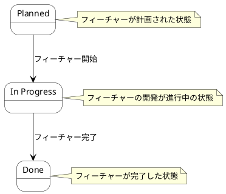

# ステートマシン図 - フィーチャー

フィーチャーの状態遷移をPlantUMLで視覚化します。

## 状態遷移図

## 状態一覧

| 状態名      | 説明                             | 遷移元      | 遷移先      | トリガーUC |
|-------------|----------------------------------|-------------|-------------|------------|
| Planned     | フィーチャーが計画された状態     | -           | In Progress | -          |
| In Progress | フィーチャーの開発が進行中の状態 | Planned     | Done        | -          |
| Done        | フィーチャーが完了した状態       | In Progress | -           | -          |
