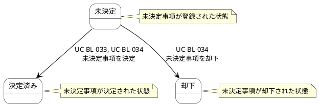

# ステートマシン図 - 未決定一覧

未決定一覧の状態遷移をPlantUMLで視覚化します。

## 状態遷移図

## 状態一覧

| 状態名   | 説明                       | 遷移元 | 遷移先         | トリガーUC           |
|----------|----------------------------|--------|----------------|----------------------|
| 未決定   | 未決定事項が登録された状態 | -      | 決定済み, 却下 | UC-BL-033, UC-BL-034 |
| 決定済み | 未決定事項が決定された状態 | 未決定 | -              | UC-BL-033, UC-BL-034 |
| 却下     | 未決定事項が却下された状態 | 未決定 | -              | UC-BL-034            |
