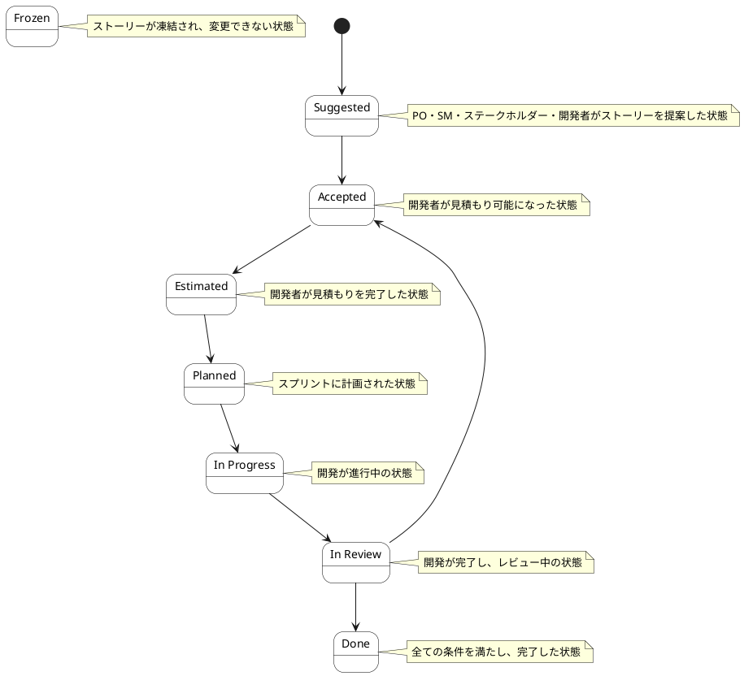

# ストーリー ステートチャート

ストーリー情報の状態遷移を示します。

## 状態一覧

| 状態ID | 状態名 | 説明 |
|--------|--------|------|
| ST-BL-12 | Frozen | ストーリーが凍結され、変更できない状態 |
| ST-BL-13 | Suggested | PO・SM・ステークホルダー・開発者がストーリーを提案した状態 |
| ST-BL-14 | Accepted | 開発者が見積もり可能になった状態 |
| ST-BL-15 | Estimated | 開発者が見積もりを完了した状態 |
| ST-BL-16 | Planned | スプリントに計画された状態 |
| ST-BL-17 | In Progress | 開発が進行中の状態 |
| ST-BL-18 | In Review | 開発が完了し、レビュー中の状態 |
| ST-BL-19 | Done | 全ての条件を満たし、完了した状態 |
