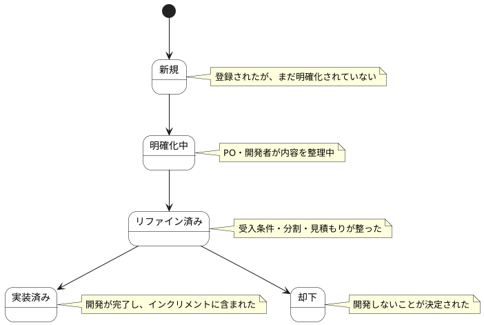

# バックログ項目 ステートチャート

バックログ項目情報の状態遷移を示します。

## 状態一覧

| 状態ID | 状態名 | 説明 |
|--------|--------|------|
| ST-BL-01 | 新規 | 登録されたが、まだ明確化されていない |
| ST-BL-02 | 明確化中 | PO・開発者が内容を整理中 |
| ST-BL-03 | リファイン済み | 受入条件・分割・見積もりが整った |
| ST-BL-04 | 実装済み | 開発が完了し、インクリメントに含まれた |
| ST-BL-05 | 却下 | 開発しないことが決定された |
