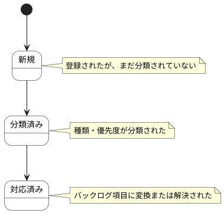

# フィードバック ステートチャート

フィードバック情報の状態遷移を示します。

## 状態一覧

| 状態ID | 状態名 | 説明 |
|--------|--------|------|
| ST-BL-06 | 新規 | 登録されたが、まだ分類されていない |
| ST-BL-07 | 分類済み | 種類・優先度が分類された |
| ST-BL-08 | 対応済み | バックログ項目に変換または解決された |
