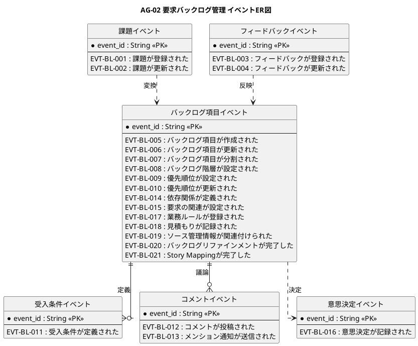
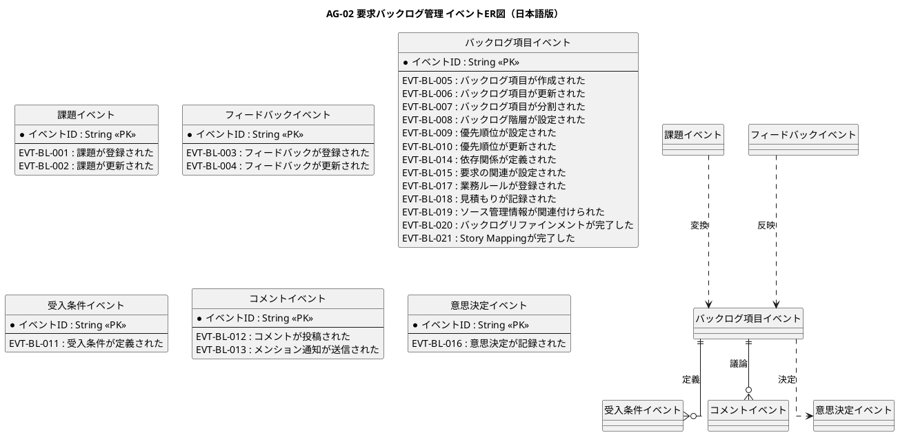

# イベントER図

要求バックログ管理業務領域で発生するドメインイベントの関係を示すER図です。

## 1. 目的

本書は、AG-02 要求バックログ管理業務領域のシステムレイヤーで発生するドメインイベント間の関係を示すER図です。

## 2. PlantUML ER図

## 3. 日本語版 ER図

## 4. イベントエンティティ一覧

| イベントエンティティ         | イベントID  | イベント名                             | 関連情報   | 集約               |
|------------------------------|-------------|----------------------------------------|------------|--------------------|
| ProblemEvents                | EVT-BL-001  | 課題が登録された                       | INF-BL-03  | バックログ項目     |
| ProblemEvents                | EVT-BL-002  | 課題が更新された                       | INF-BL-03  | バックログ項目     |
| FeedbackEvents               | EVT-BL-003  | フィードバックが登録された             | INF-BL-03  | フィードバック     |
| FeedbackEvents               | EVT-BL-004  | フィードバックが更新された             | INF-BL-03  | フィードバック     |
| BacklogItemEvents            | EVT-BL-005  | バックログ項目が作成された             | INF-BL-01  | バックログ項目     |
| BacklogItemEvents            | EVT-BL-006  | バックログ項目が更新された             | INF-BL-01  | バックログ項目     |
| BacklogItemEvents            | EVT-BL-007  | バックログ項目が分割された             | INF-BL-01  | バックログ項目     |
| BacklogItemEvents            | EVT-BL-008  | バックログ階層が設定された             | INF-BL-06  | バックログ項目     |
| BacklogItemEvents            | EVT-BL-009  | 優先順位が設定された                   | INF-BL-01  | バックログ項目     |
| BacklogItemEvents            | EVT-BL-010  | 優先順位が更新された                   | INF-BL-01  | バックログ項目     |
| BacklogItemEvents            | EVT-BL-014  | 依存関係が定義された                   | INF-BL-07  | バックログ項目     |
| BacklogItemEvents            | EVT-BL-015  | 要求の関連が設定された                 | INF-BL-07  | バックログ項目     |
| BacklogItemEvents            | EVT-BL-017  | 業務ルールが登録された                 | INF-BL-01  | バックログ項目     |
| BacklogItemEvents            | EVT-BL-018  | 見積もりが記録された                   | INF-BL-01  | バックログ項目     |
| BacklogItemEvents            | EVT-BL-019  | ソース管理情報が関連付けられた         | INF-BL-01  | バックログ項目     |
| BacklogItemEvents            | EVT-BL-020  | バックログリファインメントが完了した   | INF-BL-01  | バックログ項目     |
| BacklogItemEvents            | EVT-BL-021  | Story Mappingが完了した                | INF-BL-01  | バックログ項目     |
| AcceptanceCriteriaEvents     | EVT-BL-011  | 受入条件が定義された                   | INF-BL-02  | 受入条件           |
| CommentEvents                | EVT-BL-012  | コメントが投稿された                   | INF-BL-04  | コメント           |
| CommentEvents                | EVT-BL-013  | メンション通知が送信された             | INF-BL-04  | コメント           |
| DecisionEvents               | EVT-BL-016  | 意思決定が記録された                   | INF-BL-05  | 意思決定           |

## 5. 主要な関係

- **課題イベント → バックログ項目イベント**：課題からバックログ項目への変換
- **フィードバックイベント → バックログ項目イベント**：フィードバックの反映
- **バックログ項目イベント → 受入条件イベント**：受入条件の定義
- **バックログ項目イベント → コメントイベント**：項目に関する議論
- **バックログ項目イベント → 意思決定イベント**：項目に関する決定
