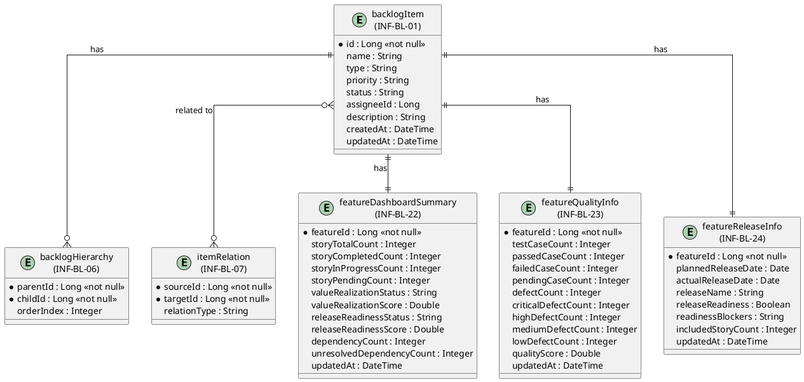
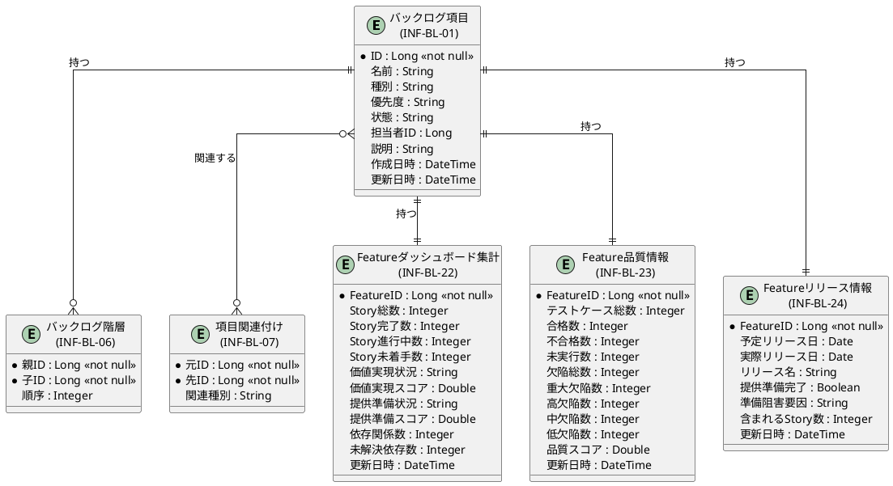

# 画面ER図

SCR-012 Featureダッシュボード画面が参照・更新する情報（エンティティ）間の関係をPlantUMLのER図で視覚化します。

## PlantUML（英語版）

## PlantUML（日本語版）

## 情報一覧

| 情報ID | 情報名 | 操作種類 | 説明 |
|--------|--------|----------|------|
| INF-BL-01 | バックログ項目 | 参照 | Feature、Storyなどのバックログ項目 |
| INF-BL-06 | バックログ階層 | 参照 | FeatureとStoryの階層関係 |
| INF-BL-07 | 項目関連付け | 参照 | Feature間の依存関係 |
| INF-BL-22 | Featureダッシュボード集計 | 参照 | Feature単位の集計情報 |
| INF-BL-23 | Feature品質情報 | 参照 | Featureのテスト結果、欠陥数、品質指標 |
| INF-BL-24 | Featureリリース情報 | 参照 | Featureのリリース予定、準備状況 |

## 関係一覧

| 元情報 | 先情報 | 関係 | 説明 |
|--------|--------|------|------|
| INF-BL-01 | INF-BL-06 | 1対多 | 1つのバックログ項目は複数の階層関係を持つ |
| INF-BL-01 | INF-BL-07 | 多対多 | バックログ項目は複数の関連付けを持つ |
| INF-BL-01 | INF-BL-22 | 1対1 | 1つのFeatureは1つの集計情報を持つ |
| INF-BL-01 | INF-BL-23 | 1対1 | 1つのFeatureは1つの品質情報を持つ |
| INF-BL-01 | INF-BL-24 | 1対1 | 1つのFeatureは1つのリリース情報を持つ |
