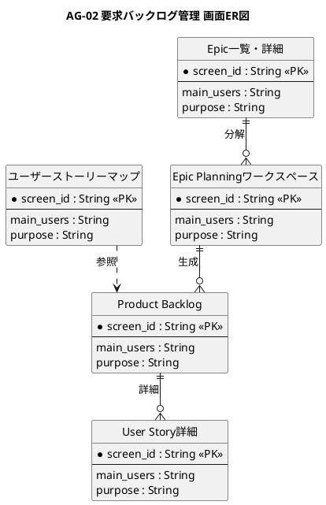

# 画面ER図

要求バックログ管理業務領域が提供する画面の関係を示すER図です。

## 1. 目的

本書は、AG-02 要求バックログ管理業務領域のシステムレイヤーで提供する画面エンティティ間の関係を示すER図です。

## 2. PlantUML ER図



## 3. 日本語版 ER図

```plantuml
@startuml
title AG-02 要求バックログ管理 画面ER図（日本語版）
hide circle
skinparam linetype ortho
skinparam shadowing false
skinparam entity {
  BackgroundColor #F8FAFC
  BorderColor #475569
  FontColor #0F172A
}
skinparam packageStyle rectangle

entity "ユーザーストーリーマップ" as UserStoryMap {
  * 画面ID : String <<PK>>
  --
  主な利用者 : String
  画面の目的 : String
}

entity "Epic一覧・詳細" as EpicList {
  * 画面ID : String <<PK>>
  --
  主な利用者 : String
  画面の目的 : String
}

entity "Epic Planningワークスペース" as EpicPlanning {
  * 画面ID : String <<PK>>
  --
  主な利用者 : String
  画面の目的 : String
}

entity "Product Backlog" as ProductBacklog {
  * 画面ID : String <<PK>>
  --
  主な利用者 : String
  画面の目的 : String
}

entity "User Story詳細" as UserStoryDetail {
  * 画面ID : String <<PK>>
  --
  主な利用者 : String
  画面の目的 : String
}

' Epic一覧からEpic Planningへ
Epic一覧・詳細 ||--o{ Epic Planningワークスペース : 分解

' Epic PlanningからProduct Backlogへ
Epic Planningワークスペース ||--o{ Product Backlog : 生成

' Product BacklogからUser Story詳細へ
Product Backlog ||--o{ User Story詳細 : 詳細

' ユーザーストーリーマップからProduct Backlogへ
ユーザーストーリーマップ ..> Product Backlog : 参照

@enduml
```

## 4. 画面エンティティ一覧

| 画面エンティティ   | 画面ID  | 画面名                   | 主な利用者                   | 画面の目的                                               |
|--------------------|---------|--------------------------|------------------------------|----------------------------------------------------------|
| UserStoryMap       | SCR-007 | ユーザーストーリーマップ | PO、開発チーム、ステークホルダー | ユーザー活動・タスク・ストーリーを並べ、価値とリリース範囲を検討する |
| EpicList           | SCR-008 | Epic一覧・詳細           | PO、チーム                   | Epicの目的、成果、状態、関連Feature、リスクを管理する     |
| EpicPlanning       | SCR-009 | Epic Planningワークスペース | PO、開発チーム             | EpicをFeature・Storyへ分解し、依存関係・優先順位・リスクを検討する |
| ProductBacklog     | SCR-010 | Product Backlog          | PO、開発チーム               | Story等を作成・編集・分割・並べ替え、優先順位を管理する   |
| UserStoryDetail    | SCR-011 | User Story詳細           | PO、開発チーム、テスト担当   | 説明、受入条件、見積り、依存関係、関連ジャーニー、履歴を管理する |

## 5. 主要な関係

- **Epic一覧・詳細 → Epic Planningワークスペース**：Epicの分解と計画
- **Epic Planningワークスペース → Product Backlog**：Feature・Storyの生成
- **Product Backlog → User Story詳細**：ストーリーの詳細管理
- **ユーザーストーリーマップ → Product Backlog**：リリース範囲の検討
