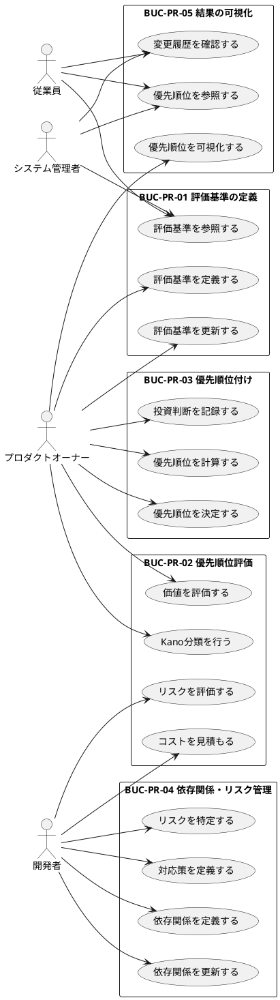

# UC複合図

優先順位決定のユースケースと関連要素をPlantUMLで視覚化します。

## ユースケース図

## 関連要素一覧

### 情報

| 情報ID | 情報名 | 関連UC |
|--------|--------|--------|
| INF-PR-01 | 優先順位モデル | UC-PR-008, UC-PR-009, UC-PR-011, UC-PR-012 |
| INF-PR-02 | 評価基準 | UC-PR-001, UC-PR-002, UC-PR-003 |
| INF-PR-03 | 評価結果 | UC-PR-004, UC-PR-005, UC-PR-006, UC-PR-007, UC-PR-008, UC-PR-015 |

### 条件

| 条件ID | 条件名 | 関連UC |
|--------|--------|--------|
| COND-PR-01 | 評価基準の必須属性 | UC-PR-001 |
| COND-PR-02 | 優先度スコアの範囲 | UC-PR-008 |
| COND-PR-03 | Kanoカテゴリの排他性 | UC-PR-005 |
| COND-PR-04 | 依存関係の循環禁止 | UC-PR-011 |
| COND-PR-05 | 状態遷移の制約 | UC-PR-004, UC-PR-008, UC-PR-009 |

### 画面

| 画面ID | 画面名 | 関連UC |
|--------|--------|--------|
| SCR-PR-001 | 優先順位一覧画面 | UC-PR-015, UC-PR-016, UC-PR-017 |
| SCR-PR-002 | 評価基準編集画面 | UC-PR-001, UC-PR-002 |
| SCR-PR-003 | 評価結果詳細画面 | UC-PR-004, UC-PR-005, UC-PR-006, UC-PR-007, UC-PR-008, UC-PR-009 |
