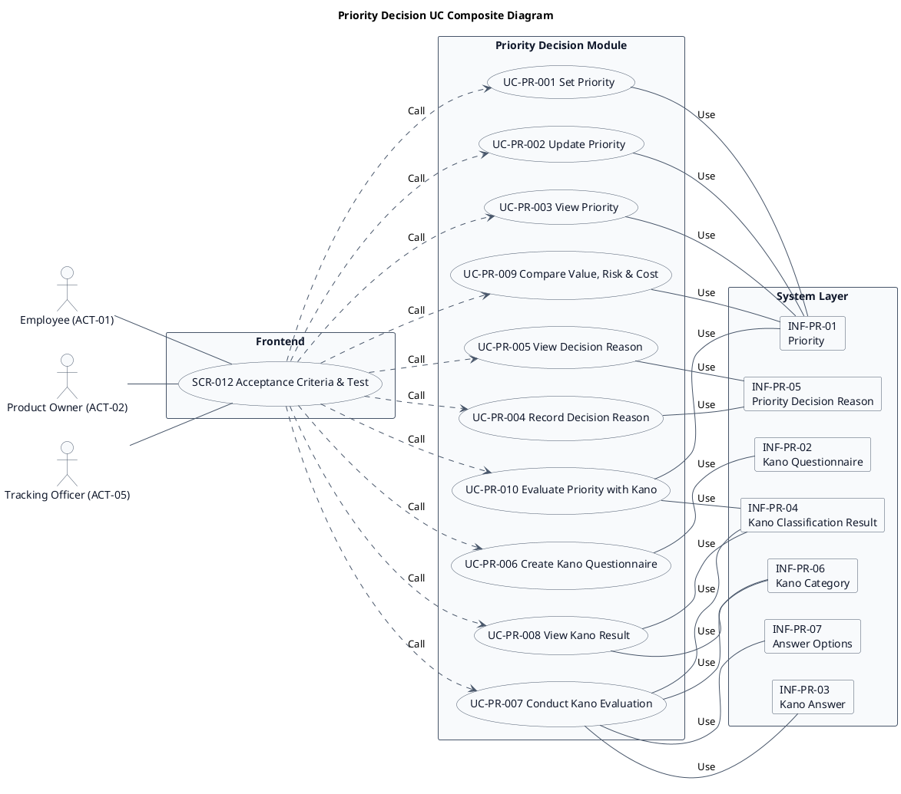
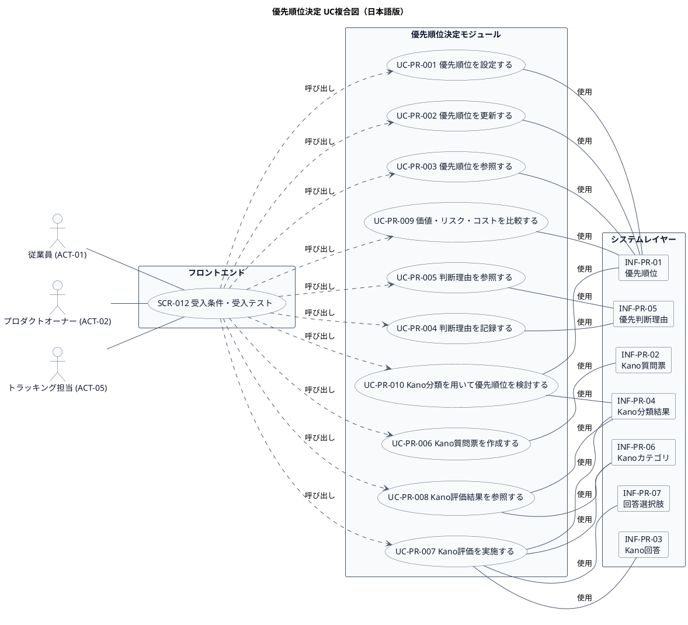

# UC複合図

優先順位決定業務領域で扱うユースケース、画面、イベント、情報などを関連づけたUC複合図です。

## 1. 目的

本書は、AG-03 優先順位決定業務領域のシステム境界レイヤーで扱うユースケース、画面、イベント、情報、条件を関連づけたUC複合図です。

## 2. PlantUML UC複合図（英語版）

## 3. 日本語版 UC複合図

## 4. ユースケース一覧

| ユースケースID | ユースケース名                     | 英語名                              | 説明                                                                   | 関連アクター               |
|----------------|------------------------------------|-------------------------------------|------------------------------------------------------------------------|----------------------------|
| UC-PR-001      | 優先順位を設定する                 | Set Priority                        | 価値・リスク・コストを踏まえてバックログ項目の順序を決める             | ACT-02                     |
| UC-PR-002      | 優先順位を更新する                 | Update Priority                     | 変更された状況に応じて項目の順序を再調整する                           | ACT-02                     |
| UC-PR-003      | 優先順位を参照する                 | View Priority                       | 現在の優先順位と変更履歴を確認する                                     | ACT-02, ACT-05             |
| UC-PR-004      | 判断理由を記録する                 | Record Decision Reason              | 優先順位決定の根拠・決定者・影響範囲を記録する                         | ACT-02                     |
| UC-PR-005      | 判断理由を参照する                 | View Decision Reason                | 優先順位決定の背景を確認する                                           | ACT-02, ACT-05             |
| UC-PR-006      | Kano質問票を作成する               | Create Kano Questionnaire           | 各要望について機能がある場合・ない場合の反応を対で定義する             | ACT-02                     |
| UC-PR-007      | Kano評価を実施する                 | Conduct Kano Evaluation             | Kano質問票に基づいて回答を収集し、品質カテゴリに分類する               | ACT-01, ACT-02             |
| UC-PR-008      | Kano評価結果を参照する             | View Kano Evaluation Result         | 要望のKano分類結果を確認する                                           | ACT-01, ACT-02, ACT-05     |
| UC-PR-009      | 価値・リスク・コストを比較する     | Compare Value, Risk & Cost          | 要求の価値、リスク、コスト、依存関係を比較する                         | ACT-02                     |
| UC-PR-010      | Kano分類を用いて優先順位を検討する | Evaluate Priority with Kano         | Kano分類を他の価値・コスト・リスク情報と合わせて優先順位判断に活用する | ACT-02                     |

## 5. 画面一覧

| 画面ID  | 画面名               | 英語名                     | 主な利用者             | 関連ユースケース |
|---------|----------------------|----------------------------|------------------------|------------------|
| SCR-012 | 受入条件・受入テスト | Acceptance Criteria & Test | PO、テスト担当、開発者 | UC-PR-001〜010   |

## 6. イベント一覧

| イベントID | イベント名                       | 英語名                           | 説明                                                                     | 関連ユースケース |
|------------|----------------------------------|----------------------------------|--------------------------------------------------------------------------|------------------|
| EVT-PR-001 | 優先順位が設定された             | Priority Set                     | 価値・リスク・コストを踏まえてバックログ項目の順序が決まった             | UC-PR-001        |
| EVT-PR-002 | 優先順位が更新された             | Priority Updated                 | 変更された状況に応じて項目の順序が再調整された                           | UC-PR-002        |
| EVT-PR-003 | 判断理由が記録された             | Decision Reason Recorded         | 優先順位決定の根拠・決定者・影響範囲が記録された                         | UC-PR-004        |
| EVT-PR-004 | Kano質問票が作成された           | Kano Questionnaire Created       | 各要望について機能がある場合・ない場合の反応が対で定義された             | UC-PR-006        |
| EVT-PR-005 | Kano評価が完了した               | Kano Evaluation Completed        | Kano質問票に基づいて回答が収集され、品質カテゴリに分類された             | UC-PR-007        |
| EVT-PR-006 | 価値・リスク・コストが比較された | Value, Risk & Cost Compared      | 要求の価値、リスク、コスト、依存関係が比較された                         | UC-PR-009        |
| EVT-PR-007 | Kano分類が優先順位に反映された   | Kano Classification Reflected    | Kano分類を他の価値・コスト・リスク情報と合わせて優先順位判断に活用された | UC-PR-010        |

## 7. 情報一覧

| 情報ID    | 情報名       | 英語名                  | 情報種類 | 説明                                                   | 関連ユースケース |
|-----------|--------------|-------------------------|----------|--------------------------------------------------------|------------------|
| INF-PR-01 | 優先順位     | Priority                | リソース | バックログ項目の順序と優先理由                         | UC-PR-001〜003, 009〜010 |
| INF-PR-02 | Kano質問票   | Kano Questionnaire      | リソース | 充足質問・不充足質問のペア                             | UC-PR-006        |
| INF-PR-03 | Kano回答     | Kano Answer             | リソース | 各質問に対する回答                                     | UC-PR-007        |
| INF-PR-04 | Kano分類結果 | Kano Classification Result | リソース | 回答から導出された品質カテゴリ                         | UC-PR-007〜008, 010 |
| INF-PR-05 | 優先判断理由 | Priority Decision Reason | リソース | 優先順位決定の根拠・決定者・影響範囲                   | UC-PR-004〜005   |
| INF-PR-06 | Kanoカテゴリ | Kano Category           | 対照表   | 当たり前品質、一元品質、魅力的品質、無関心品質、逆品質 | UC-PR-007〜008   |
| INF-PR-07 | 回答選択肢   | Answer Options          | 対照表   | 満足、当たり前、無関心、仕方ない、不満                 | UC-PR-007        |

## 8. 参照情報

- ユースケース一覧: `01.ユースケース/ユースケース一覧.md`
- 画面一覧: `04.システム/04.画面/画面一覧.md`
- イベント一覧: `04.システム/03.イベント/イベント一覧.md`
- 情報一覧: `04.システム/01.情報/情報一覧.md`
