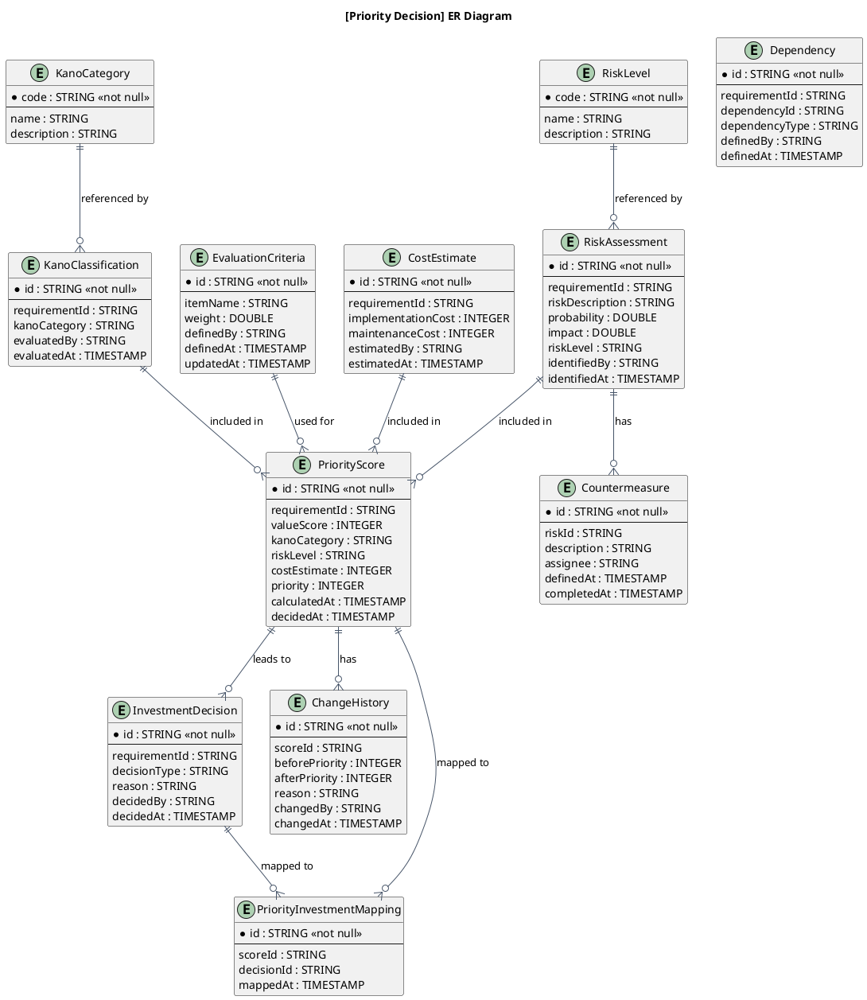
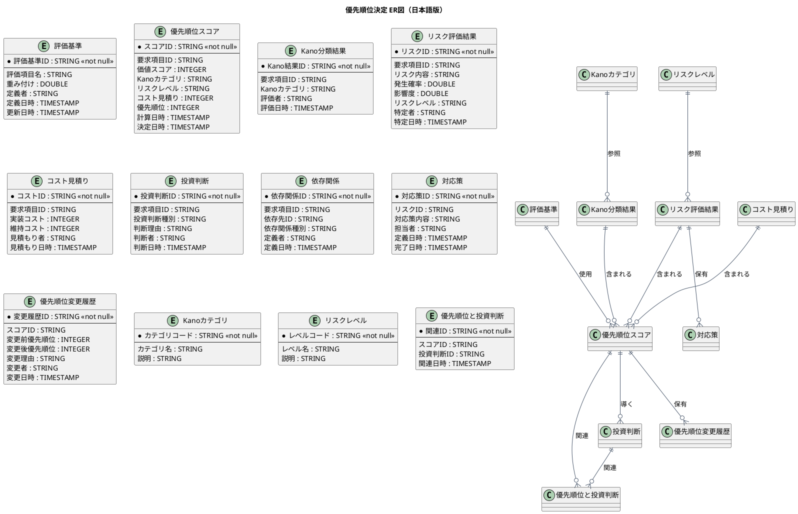

# ER図

優先順位決定業務領域で扱う情報（エンティティ）間の関係を示すER図です。

## 1. 目的

本書は、AG-03 優先順位決定業務領域のシステムレイヤーで扱う情報（エンティティ）間の関係を示すER図（エンティティ関係図）です。

## 2. PlantUML ER図（英語版）

## 3. 日本語版 ER図

## 4. 情報（エンティティ）一覧

| 情報ID   | 情報名             | 英語名                  | 説明                                                     | 情報種類 |
|----------|--------------------|-------------------------|----------------------------------------------------------|----------|
| INF-PR-01 | 評価基準           | EvaluationCriteria      | 優先順位付けの評価基準（価値、Kano、リスク、コスト）     | リソース |
| INF-PR-02 | 優先順位スコア     | PriorityScore           | 評価結果に基づく優先順位スコア                           | リソース |
| INF-PR-03 | Kano分類結果       | KanoClassification      | Kano評価の結果                                           | リソース |
| INF-PR-04 | リスク評価結果     | RiskAssessment          | リスクの特定・評価結果                                   | リソース |
| INF-PR-05 | コスト見積り       | CostEstimate            | 実装コスト・維持コストの見積もり                         | リソース |
| INF-PR-06 | 投資判断           | InvestmentDecision      | 優先順位に基づく投資判断とその理由                       | リソース |
| INF-PR-07 | 依存関係           | Dependency              | 要求間の依存関係                                         | リソース |
| INF-PR-08 | 対応策             | Countermeasure          | リスクへの対応策                                         | リソース |
| INF-PR-09 | 優先順位変更履歴   | ChangeHistory           | 優先順位変更の履歴・理由                                 | リソース |
| INF-PR-10 | Kanoカテゴリ       | KanoCategory            | 当たり前品質、一元品質、魅力的品質、無関心品質、逆品質   | 対照表   |
| INF-PR-11 | リスクレベル       | RiskLevel               | 高、中、低                                               | 対照表   |
| INF-PR-12 | 優先順位と投資判断 | PriorityInvestmentMapping | 優先順位と投資判断の関連                               | 対応表   |

## 5. 関係一覧

| 関係ID | 元情報ID | 元情報名       | 先情報ID | 先情報名         | 関係の種類 | 説明                                     |
|--------|----------|----------------|----------|------------------|------------|------------------------------------------|
| REL-01 | INF-PR-01 | 評価基準       | INF-PR-02 | 優先順位スコア   | 1対多      | 評価基準は複数の優先順位スコアに使用される |
| REL-02 | INF-PR-03 | Kano分類結果   | INF-PR-02 | 優先順位スコア   | 1対1       | Kano分類結果は優先順位スコアに含まれる   |
| REL-03 | INF-PR-04 | リスク評価結果 | INF-PR-02 | 優先順位スコア   | 1対1       | リスク評価結果は優先順位スコアに含まれる |
| REL-04 | INF-PR-05 | コスト見積り   | INF-PR-02 | 優先順位スコア   | 1対1       | コスト見積りは優先順位スコアに含まれる   |
| REL-05 | INF-PR-02 | 優先順位スコア | INF-PR-06 | 投資判断         | 1対多      | 優先順位スコアは投資判断を導く           |
| REL-06 | INF-PR-02 | 優先順位スコア | INF-PR-09 | 優先順位変更履歴 | 1対多      | 優先順位スコアの変更履歴が記録される     |
| REL-07 | INF-PR-04 | リスク評価結果 | INF-PR-08 | 対応策           | 1対多      | リスク評価結果には複数の対応策が定義される |
| REL-08 | INF-PR-10 | Kanoカテゴリ   | INF-PR-03 | Kano分類結果     | 1対多      | Kanoカテゴリは複数のKano分類結果で参照される |
| REL-09 | INF-PR-11 | リスクレベル   | INF-PR-04 | リスク評価結果   | 1対多      | リスクレベルは複数のリスク評価結果で参照される |
| REL-10 | INF-PR-02 | 優先順位スコア | INF-PR-12 | 優先順位と投資判断 | 1対多    | 優先順位スコアは投資判断と関連する       |
| REL-11 | INF-PR-06 | 投資判断       | INF-PR-12 | 優先順位と投資判断 | 1対多    | 投資判断は優先順位と関連する             |

## 6. 関係の種類

関係の種類は以下の記号で表現します：

| 記号 | 意味 | 説明 |
|------|------|------|
| `||--o{` | 1対多 (1:N) | 左側の1つが右側の0個以上に関連 |
| `||--||` | 1対1 (1:1) | 左側の1つが右側の1つに関連 |
| `}o--o{` | 多対多 (N:M) | 左側の0個以上が右側の0個以上に関連 |
| `||--o|` | 1対1以上 (1:1+) | 左側の1つが右側の1個以上に関連 |

## 7. 参照情報

- 情報一覧: `04.システム/01.情報/情報一覧.md`
- 情報属性一覧: `04.システム/03.情報属性/`
- UC複合図: `03.システム境界/UC複合図.md`
