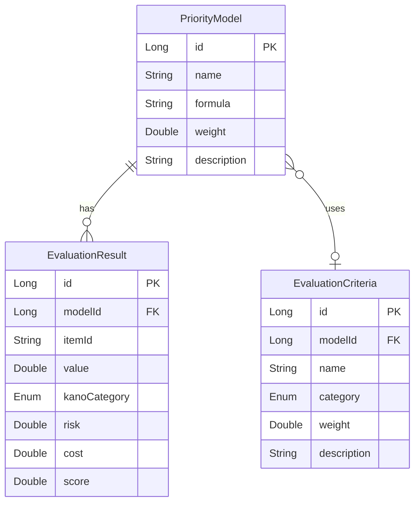

# 論理データモデル

優先順位決定の論理データモデルを定義します。

## ER図

## 論理データ一覧

| エンティティ | 説明 | 主キー | 外部キー | 関連エンティティ |
|-------------|------|--------|----------|-----------------|
| PriorityModel | 優先順位の計算モデル | id | - | EvaluationResult (1対多), EvaluationCriteria (1対多) |
| EvaluationCriteria | 優先順位の評価基準 | id | modelId | PriorityModel (多対1) |
| EvaluationResult | 優先順位の評価結果 | id | modelId | PriorityModel (多対1) |

## エンティティ詳細

### PriorityModel

| 属性名 | 型 | 必須 | 説明 |
|--------|----|------|------|
| id | Long | 必須 | 優先順位モデルの一意な識別子 |
| name | String | 必須 | モデルの名前 |
| formula | String | 必須 | 計算式 |
| weight | Double | 任意 | 重み |
| description | String | 任意 | 説明 |

### EvaluationCriteria

| 属性名 | 型 | 必須 | 説明 |
|--------|----|------|------|
| id | Long | 必須 | 評価基準の一意な識別子 |
| modelId | Long | 必須 | 関連する優先順位モデルのID |
| name | String | 必須 | 基準の名前 |
| category | Enum | 必須 | カテゴリ（価値, Kano, リスク, コスト） |
| weight | Double | 必須 | 重み |
| description | String | 任意 | 説明 |

### EvaluationResult

| 属性名 | 型 | 必須 | 説明 |
|--------|----|------|------|
| id | Long | 必須 | 評価結果の一意な識別子 |
| modelId | Long | 必須 | 関連する優先順位モデルのID |
| itemId | String | 必須 | 評価対象の項目ID |
| value | Double | 必須 | 価値スコア |
| kanoCategory | Enum | 任意 | Kanoカテゴリ |
| risk | Double | 任意 | リスクスコア |
| cost | Double | 任意 | コスト |
| score | Double | 必須 | 優先度スコア |
