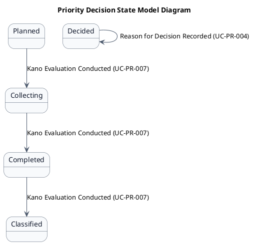
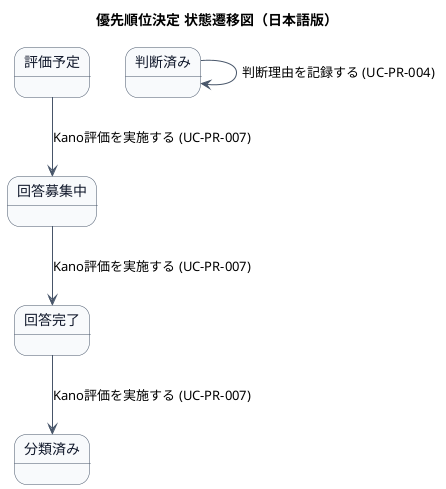

# ステートマシン図

優先順位決定業務領域で扱う情報の状態遷移を示す状態モデル図です。

## 1. 目的

本書は、AG-03 優先順位決定業務領域のシステムレイヤーで扱う情報の状態遷移を示す状態モデル図（ステートマシン図）です。

## 2. PlantUML 状態遷移図（英語版）

## 3. 日本語版 状態遷移図

## 4. 状態一覧

| 状態名 (ID)       | 英語名        | 対象情報     | 説明                                     |
|-------------------|---------------|--------------|------------------------------------------|
| 評価予定 (ST-PR-01) | Planned     | Kano質問票   | 質問票が作成され、回答収集が開始される予定 |
| 回答募集中 (ST-PR-02) | Collecting | Kano質問票   | 回答の収集が進行中                       |
| 回答完了 (ST-PR-03) | Completed   | Kano質問票   | 回答収集が完了し、分類処理が可能         |
| 分類済み (ST-PR-04) | Classified  | Kano分類結果 | 回答から品質カテゴリが導出された         |
| 判断済み (ST-PR-05) | Decided     | 優先判断理由 | POが優先順位の判断を記録した             |

## 5. 遷移一覧

| 遷移ID | 元状態       | 遷移先状態 | トリガー                          | 関連ユースケース              | 説明                                     |
|--------|--------------|------------|-----------------------------------|-------------------------------|------------------------------------------|
| TR-PR-01 | 評価予定  | 回答募集中 | Kano評価を実施する (UC-PR-007)     | UC-PR-007                    | 回答収集が開始された                     |
| TR-PR-02 | 回答募集中 | 回答完了   | Kano評価を実施する (UC-PR-007)     | UC-PR-007                    | 回答収集が完了した                       |
| TR-PR-03 | 回答完了  | 分類済み   | Kano評価を実施する (UC-PR-007)     | UC-PR-007                    | 回答から品質カテゴリが導出された         |
| TR-PR-04 | 判断済み  | 判断済み   | 判断理由を記録する (UC-PR-004)     | UC-PR-004                    | 優先順位の判断が記録された               |

## 6. 参照情報

- ステート一覧: `02.ステート/ステート一覧.tsv`
- 関連ユースケース: `03.システム境界/01.ユースケース/ユースケース一覧.md`
