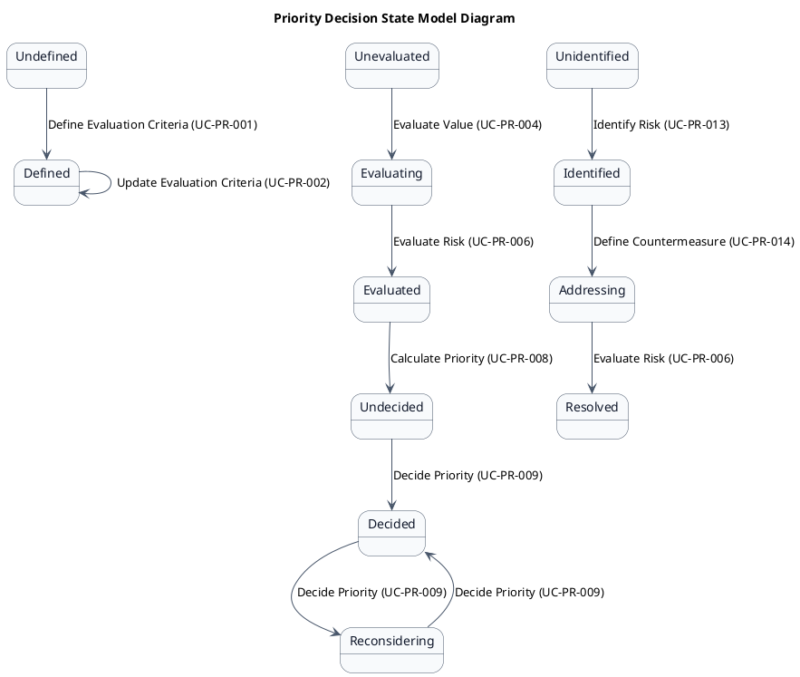
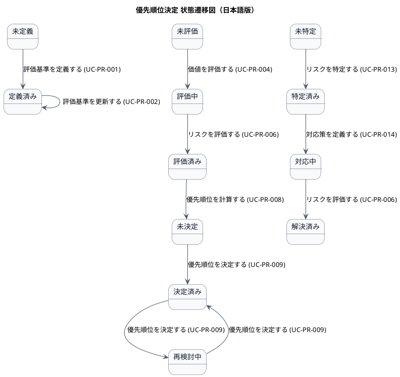

# ステートマシン図

優先順位決定業務領域で扱う情報の状態遷移を示す状態モデル図です。

## 1. 目的

本書は、AG-03 優先順位決定業務領域のシステムレイヤーで扱う情報の状態遷移を示す状態モデル図（ステートマシン図）です。

## 2. PlantUML 状態遷移図（英語版）

## 3. 日本語版 状態遷移図

## 4. 状態一覧

| 状態名 (ID)       | 英語名        | 対象情報       | 説明                                     |
|-------------------|---------------|----------------|------------------------------------------|
| 未定義 (ST-PR-01) | Undefined     | 評価基準       | 評価基準がまだ定義されていない           |
| 定義済み (ST-PR-02) | Defined    | 評価基準       | 評価基準が定義された                     |
| 未評価 (ST-PR-03) | Unevaluated   | 優先順位スコア | 要求項目の評価がまだ行われていない       |
| 評価中 (ST-PR-04) | Evaluating    | 優先順位スコア | 要求項目の評価が行われている             |
| 評価済み (ST-PR-05) | Evaluated  | 優先順位スコア | 要求項目の評価が完了した                 |
| 未決定 (ST-PR-06) | Undecided     | 優先順位スコア | 優先順位がまだ決定されていない           |
| 決定済み (ST-PR-07) | Decided    | 優先順位スコア | 優先順位が決定された                     |
| 再検討中 (ST-PR-08) | Reconsidering | 優先順位スコア | 優先順位の再検討が行われている           |
| 未特定 (ST-PR-09) | Unidentified  | リスク評価結果 | リスクがまだ特定されていない             |
| 特定済み (ST-PR-10) | Identified | リスク評価結果 | リスクが特定された                       |
| 対応中 (ST-PR-11) | Addressing    | 対応策         | リスクへの対応策が実施されている         |
| 解決済み (ST-PR-12) | Resolved   | リスク評価結果 | リスクが解消された                       |

## 5. 遷移一覧

| 遷移ID | 元状態       | 遷移先状態 | トリガー                          | 関連ユースケース              | 説明                                     |
|--------|--------------|------------|-----------------------------------|-------------------------------|------------------------------------------|
| TR-PR-01 | 未定義    | 定義済み   | 評価基準を定義する (UC-PR-001)     | UC-PR-001                    | 評価基準が定義された                     |
| TR-PR-02 | 定義済み  | 定義済み   | 評価基準を更新する (UC-PR-002)     | UC-PR-002                    | 評価基準が更新された                     |
| TR-PR-03 | 未評価    | 評価中     | 価値を評価する (UC-PR-004)         | UC-PR-004                    | 価値評価が開始された                     |
| TR-PR-04 | 評価中    | 評価済み   | リスクを評価する (UC-PR-006)       | UC-PR-006                    | 評価が完了した                           |
| TR-PR-05 | 評価済み  | 未決定     | 優先順位を計算する (UC-PR-008)     | UC-PR-008                    | 優先順位スコアが計算された               |
| TR-PR-06 | 未決定    | 決定済み   | 優先順位を決定する (UC-PR-009)     | UC-PR-009                    | 優先順位が決定された                     |
| TR-PR-07 | 決定済み  | 再検討中   | 優先順位を決定する (UC-PR-009)     | UC-PR-009                    | 優先順位の再検討が開始された             |
| TR-PR-08 | 再検討中  | 決定済み   | 優先順位を決定する (UC-PR-009)     | UC-PR-009                    | 再検討後の優先順位が決定された           |
| TR-PR-09 | 未特定    | 特定済み   | リスクを特定する (UC-PR-013)       | UC-PR-013                    | リスクが特定された                       |
| TR-PR-10 | 特定済み  | 対応中     | 対応策を定義する (UC-PR-014)       | UC-PR-014                    | 対応策が定義された                       |
| TR-PR-11 | 対応中    | 解決済み   | リスクを評価する (UC-PR-006)       | UC-PR-006                    | リスクが解消された                       |

## 6. 参照情報

- ステート一覧: `02.ステート/ステート一覧.tsv`
- 関連ユースケース: `03.システム境界/01.ユースケース/ユースケース一覧.md`
