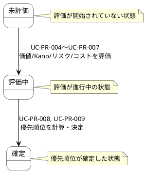

# ステートマシン図

優先順位決定の状態遷移をPlantUMLで視覚化します。

## 評価の状態遷移

## 状態一覧

| 状態名 | 説明 | 遷移元 | 遷移先 | トリガーUC |
|--------|------|--------|--------|-----------|
| 未評価 | 評価が開始されていない状態 | - | 評価中 | UC-PR-004〜UC-PR-007 |
| 評価中 | 評価が進行中の状態 | 未評価 | 確定 | UC-PR-008, UC-PR-009 |
| 確定 | 優先順位が確定した状態 | 評価中 | - | - |
