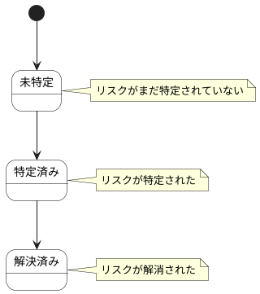

# リスク評価結果 ステートチャート

リスク評価結果情報の状態遷移を示します。

## 状態一覧

| 状態ID | 状態名 | 説明 |
|--------|--------|------|
| ST-PR-09 | 未特定 | リスクがまだ特定されていない |
| ST-PR-10 | 特定済み | リスクが特定された |
| ST-PR-12 | 解決済み | リスクが解消された |
