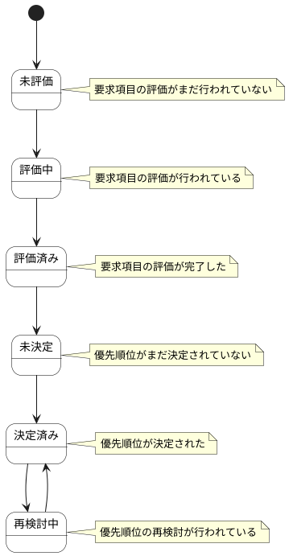

# 優先順位スコア ステートチャート

優先順位スコア情報の状態遷移を示します。

## 状態一覧

| 状態ID | 状態名 | 説明 |
|--------|--------|------|
| ST-PR-03 | 未評価 | 要求項目の評価がまだ行われていない |
| ST-PR-04 | 評価中 | 要求項目の評価が行われている |
| ST-PR-05 | 評価済み | 要求項目の評価が完了した |
| ST-PR-06 | 未決定 | 優先順位がまだ決定されていない |
| ST-PR-07 | 決定済み | 優先順位が決定された |
| ST-PR-08 | 再検討中 | 優先順位の再検討が行われている |
