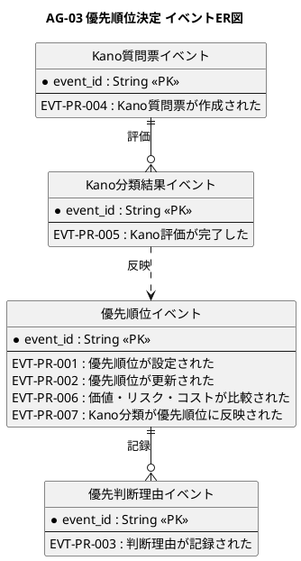
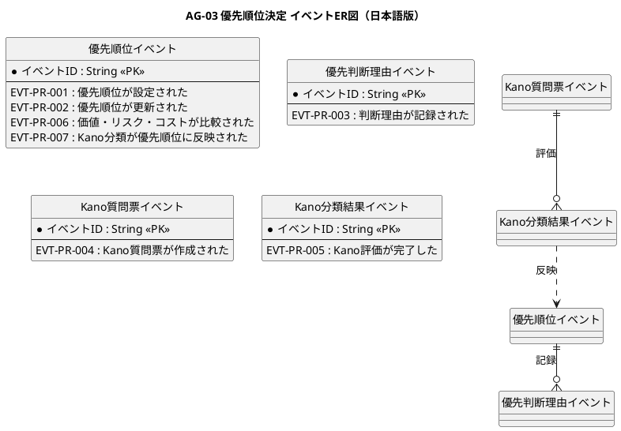

# イベントER図

優先順位決定業務領域で発生するドメインイベントの関係を示すER図です。

## 1. 目的

本書は、AG-03 優先順位決定業務領域のシステムレイヤーで発生するドメインイベント間の関係を示すER図です。

## 2. PlantUML ER図

## 3. 日本語版 ER図

## 4. イベントエンティティ一覧

| イベントエンティティ     | イベントID  | イベント名                             | 関連情報   | 集約               |
|--------------------------|-------------|----------------------------------------|------------|--------------------|
| PriorityEvents           | EVT-PR-001  | 優先順位が設定された                   | INF-PR-01  | 優先順位           |
| PriorityEvents           | EVT-PR-002  | 優先順位が更新された                   | INF-PR-01  | 優先順位           |
| PriorityEvents           | EVT-PR-006  | 価値・リスク・コストが比較された       | INF-PR-01  | 優先順位           |
| PriorityEvents           | EVT-PR-007  | Kano分類が優先順位に反映された         | INF-PR-04  | 優先順位           |
| PriorityReasonEvents     | EVT-PR-003  | 判断理由が記録された                   | INF-PR-05  | 優先判断理由       |
| KanoQuestionEvents       | EVT-PR-004  | Kano質問票が作成された                 | INF-PR-02  | Kano質問票         |
| KanoResultEvents         | EVT-PR-005  | Kano評価が完了した                     | INF-PR-04  | Kano分類結果       |

## 5. 主要な関係

- **Kano質問票イベント → Kano分類結果イベント**：質問票に基づく評価
- **Kano分類結果イベント → 優先順位イベント**：Kano分類の優先順位への反映
- **優先順位イベント → 優先判断理由イベント**：優先順位決定の理由記録
