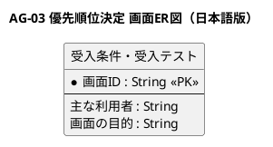

# 画面ER図

優先順位決定業務領域が提供する画面の関係を示すER図です。

## 1. 目的

本書は、AG-03 優先順位決定業務領域のシステムレイヤーで提供する画面エンティティ間の関係を示すER図です。

## 2. PlantUML ER図

```plantuml
@startuml
title AG-03 優先順位決定 画面ER図
hide circle
skinparam linetype ortho
skinparam shadowing false
skinparam entity {
  BackgroundColor #F8FAFC
  BorderColor #475569
  FontColor #0F172A
}
skinparam packageStyle rectangle

entity "受入条件・受入テスト" as AcceptanceTest {
  * screen_id : String <<PK>>
  --
  main_users : String
  purpose : String
}

@enduml
```

## 3. 日本語版 ER図

## 4. 画面エンティティ一覧

| 画面エンティティ   | 画面ID  | 画面名             | 主な利用者         | 画面の目的                                               |
|--------------------|---------|--------------------|--------------------|----------------------------------------------------------|
| AcceptanceTest     | SCR-012 | 受入条件・受入テスト | PO、テスト担当、開発者 | 受入条件とテストケースを定義し、実行結果と判定を記録する |

## 5. 主要な関係

- 本業務領域は1つの画面のみ提供します。
- 受入条件・受入テスト画面は、AG-02 要求バックログ管理のProduct Backlog画面から参照されます。
