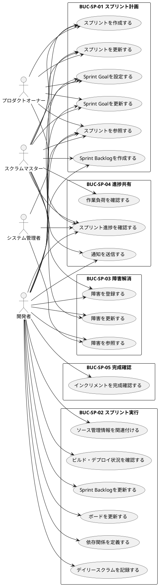

# UC複合図

スプリント実行のユースケースと関連要素をPlantUMLで視覚化します。

## ユースケース図

## 関連要素一覧

### 情報

| 情報ID | 情報名 | 関連UC |
|--------|--------|--------|
| INF-SP-01 | スプリント | UC-SP-001, UC-SP-002, UC-SP-003, UC-SP-004, UC-SP-005 |
| INF-SP-02 | スプリントバックログ | UC-SP-006, UC-SP-007, UC-SP-008, UC-SP-012, UC-SP-015 |
| INF-SP-03 | 進捗 | UC-SP-014, UC-SP-017 |
| INF-SP-04 | バーンダウンチャート | UC-SP-014 |

### 条件

| 条件ID | 条件名 | 関連UC |
|--------|--------|--------|
| COND-SP-01 | スプリント期間の制約 | UC-SP-001 |
| COND-SP-02 | タスクの担当者必須 | UC-SP-007 |
| COND-SP-03 | 依存関係の循環禁止 | UC-SP-012 |
| COND-SP-04 | 状態遷移の制約 | UC-SP-001, UC-SP-002, UC-SP-007, UC-SP-008 |
| COND-SP-05 | インクリメントの完成条件 | UC-SP-015 |

### 画面

| 画面ID | 画面名 | 関連UC |
|--------|--------|--------|
| SCR-SP-001 | スプリント一覧画面 | UC-SP-003, UC-SP-014 |
| SCR-SP-002 | スプリント詳細画面 | UC-SP-001, UC-SP-002, UC-SP-004, UC-SP-005, UC-SP-006 |
| SCR-SP-003 | カンバンボード画面 | UC-SP-007, UC-SP-008, UC-SP-009, UC-SP-010, UC-SP-011, UC-SP-012, UC-SP-013, UC-SP-015, UC-SP-017, UC-SP-018, UC-SP-019 |
