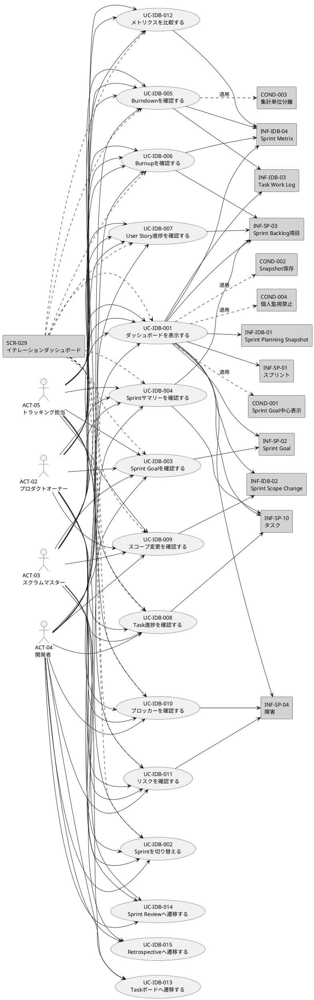

# UC複合図（イテレーションダッシュボード）

イテレーションダッシュボード機能のユースケース、画面、イベント、情報、条件の関係性をPlantUMLで表現します。

## PlantUML

## 要素一覧

### アクター

| ID | 名前 | 説明 |
|----|------|------|
| ACT-02 | プロダクトオーナー | Sprint GoalとProduct Backlogの優先順位を踏まえ、成果を確認 |
| ACT-03 | スクラムマスター | 進捗の停滞、障害、チームの改善機会を発見 |
| ACT-04 | 開発者 | チーム全体の進捗、自分の作業、ブロッカーを確認 |
| ACT-05 | トラッキング担当 | スプリントの進捗や成果を把握 |

### 画面

| ID | 名前 | 説明 |
|----|------|------|
| SCR-029 | イテレーションダッシュボード | スプリントの進捗・成果・リスクを可視化する |

### 情報

| ID | 名前 | 説明 |
|----|------|------|
| INF-SP-01 | スプリント | スプリント基本情報 |
| INF-SP-02 | Sprint Goal | 目標と達成状況 |
| INF-SP-03 | Sprint Backlog項目 | 選択されたStory・Task |
| INF-SP-04 | 障害 | ブロッカー情報 |
| INF-SP-10 | タスク | Taskの状態・残作業 |
| INF-IDB-01 | Sprint Planning Snapshot | 計画時点のSnapshot |
| INF-IDB-02 | Sprint Scope Change | スコープ変更履歴 |
| INF-IDB-03 | Task Work Log | 作業実績 |
| INF-IDB-04 | Sprint Metrix | 集計メトリクス |

### 条件（業務ルール）

| ID | 名前 | 種類 | 説明 |
|----|------|------|------|
| COND-001 | Sprint Goal中心表示 | Policy | ダッシュボードはSprint Goalの達成状況を最優先に表示する |
| COND-002 | Snapshot保存 | Operation | Sprint Planning完了時に計画情報をSnapshotとして保存する |
| COND-003 | 集計単位分離 | Policy | Story PointsとTask残作業時間は別のグラフに表示する |
| COND-004 | 個人監視禁止 | Policy | 個人の生産性を評価するための画面にしない |
