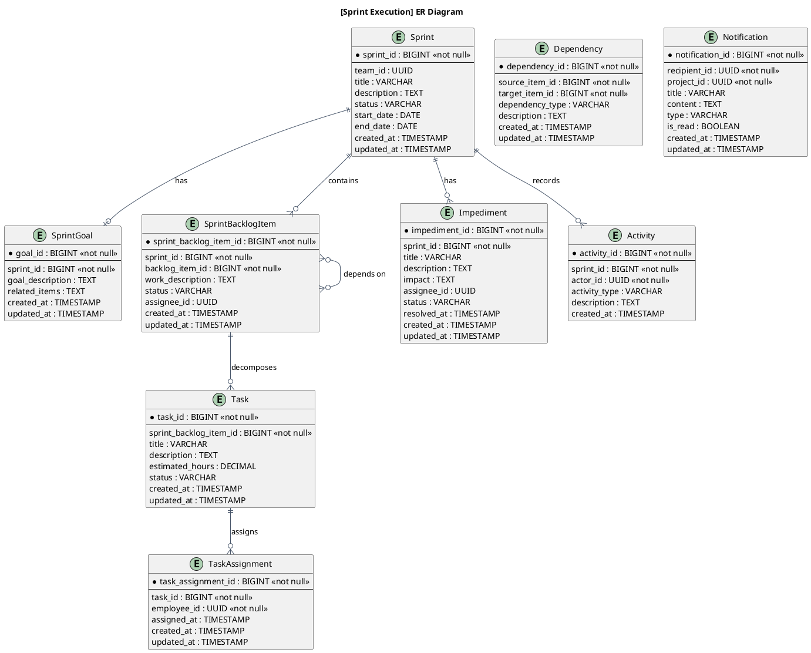
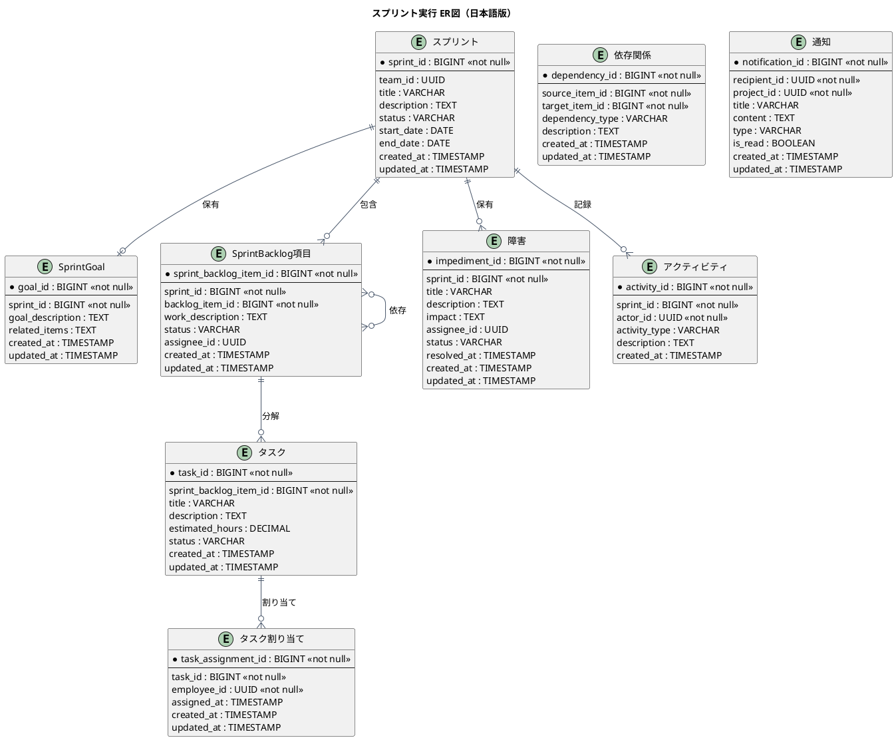

# ER図

スプリント実行とインクリメント形成業務領域で扱う情報（エンティティ）間の関係を示すER図です。

## 1. 目的

本書は、AG-04 スプリント実行とインクリメント形成業務領域のシステムレイヤーで扱う情報（エンティティ）間の関係を示すER図（エンティティ関係図）です。

## 2. PlantUML ER図（英語版）

## 3. 日本語版 ER図

## 4. 情報（エンティティ）一覧

| 情報ID    | 情報名             | 英語名              | 説明                                 | 情報種類 |
|-----------|--------------------|---------------------|--------------------------------------|----------|
| INF-SP-01 | スプリント         | Sprint              | スプリント期間、状態、チーム         | リソース |
| INF-SP-02 | Sprint Goal        | SprintGoal          | スプリントの目的と関連項目           | リソース |
| INF-SP-03 | Sprint Backlog項目 | SprintBacklogItem   | 選択項目、作業、状態、担当           | リソース |
| INF-SP-04 | 障害               | Impediment          | 阻害要因、影響、担当、解消状況       | リソース |
| INF-SP-05 | 依存関係           | Dependency          | 項目間・チーム間の依存               | 対応表   |
| INF-SP-06 | 通知               | Notification        | メンション、担当変更、期限、判断待ち | イベント |
| INF-SP-07 | アクティビティ     | Activity            | 作業状態変更、コメント追加など       | イベント |
| INF-SP-08 | スプリント状態     | SprintStatus        | 計画済み、実行中、完了、キャンセル   | 対照表   |
| INF-SP-09 | 作業状態           | TaskStatus          | 未着手、作業中、レビュー中、完了     | 対照表   |

## 5. 関係一覧

| 関係ID | 元情報ID | 元情報名             | 先情報ID | 先情報名             | 関係の種類 | 説明                                   |
|--------|----------|----------------------|----------|----------------------|------------|----------------------------------------|
| REL-01 | INF-SP-01 | スプリント           | INF-SP-02 | Sprint Goal          | 1対1       | スプリントは1つのSprint Goalを保有     |
| REL-02 | INF-SP-01 | スプリント           | INF-SP-03 | Sprint Backlog項目   | 1対多      | スプリントは複数のBacklog項目を包含    |
| REL-03 | INF-SP-01 | スプリント           | INF-SP-04 | 障害                 | 1対多      | スプリントは複数の障害を保有           |
| REL-04 | INF-SP-01 | スプリント           | INF-SP-07 | アクティビティ       | 1対多      | スプリントは複数のアクティビティを記録 |
| REL-05 | INF-SP-03 | Sprint Backlog項目   | INF-SP-09 | タスク               | 1対多      | Backlog項目は複数のタスクに分解        |
| REL-06 | INF-SP-09 | タスク               | INF-SP-10 | タスク割り当て       | 1対多      | タスクは複数の割り当てを持つ           |
| REL-07 | INF-SP-03 | Sprint Backlog項目   | INF-SP-03 | Sprint Backlog項目   | 多対多     | Backlog項目間は依存関係を持つ          |

## 6. 関係の種類

関係の種類は以下の記号で表現します：

| 記号 | 意味 | 説明 |
|------|------|------|
| `||--o{` | 1対多 (1:N) | 左側の1つが右側の0個以上に関連 |
| `||--||` | 1対1 (1:1) | 左側の1つが右側の1つに関連 |
| `}o--o{` | 多対多 (N:M) | 左側の0個以上が右側の0個以上に関連 |
| `||--o|` | 1対1以上 (1:1+) | 左側の1つが右側の1個以上に関連 |

## 7. 参照情報

- 情報一覧: `04.システム/01.情報/情報一覧.md`
- 情報属性一覧: `04.システム/01.情報/02.属性/`
- UC複合図: `03.システム境界/UC複合図.md`
