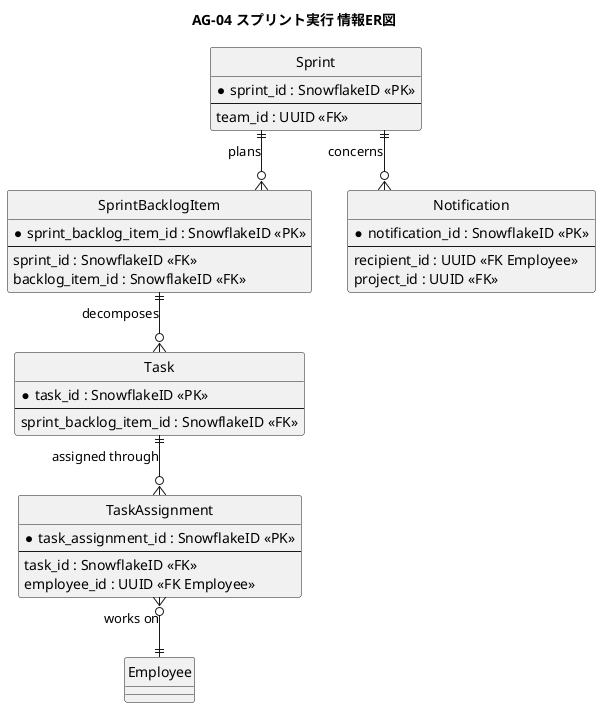
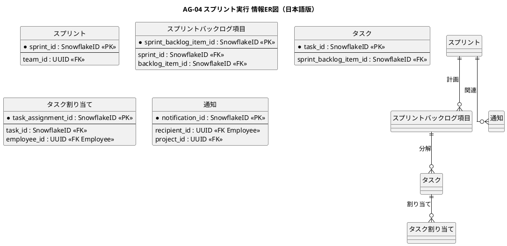

# 情報ER図

スプリント実行とインクリメント形成業務領域で扱う情報の関係を示すER図です。

## 1. 目的

本書は、AG-04 スプリント実行業務領域のシステムレイヤーで扱う情報エンティティ間の関係を示すER図です。

## 2. PlantUML ER図

## 3. 日本語版 ER図

## 4. エンティティ一覧

| エンティティ      | 情報名 (ID)                    | 説明                                 |
|-------------------|--------------------------------|--------------------------------------|
| Sprint            | スプリント (INF-SP-01)         | スプリント期間、状態、チーム         |
| SprintBacklogItem | Sprint Backlog項目 (INF-SP-03) | 選択項目、作業、状態、担当           |
| Task              | タスク                         | 作業項目、見積もり、状態             |
| TaskAssignment    | 作業担当                       | 作業と担当者の割り当て               |
| Notification      | 通知 (INF-SP-06)               | メンション、担当変更、期限、判断待ち |

## 5. 主要な関係

- **Sprint → SprintBacklogItem**：スプリントで計画されたバックログ項目
- **SprintBacklogItem → Task**：バックログ項目を分解した作業
- **Task → TaskAssignment**：作業の担当者割り当て
- **Sprint → Notification**：スプリントに関連する通知

## 6. 参照エンティティ

以下のエンティティは他の業務領域で定義され、参照として使用されます。

| エンティティ | 所属業務領域 | 説明           |
|--------------|--------------|----------------|
| Team         | 共通         | 開発チーム     |
| BacklogItem  | AG-02        | バックログ項目 |
| Employee     | 共通         | 従業員         |
| Project      | 共通         | プロジェクト   |
