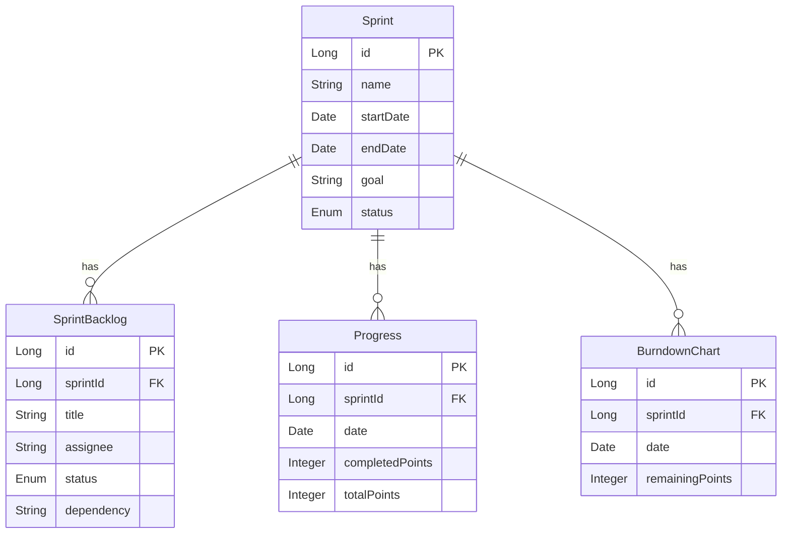

# 論理データモデル

スプリント実行の論理データモデルを定義します。

## ER図

## 論理データ一覧

| エンティティ | 説明 | 主キー | 外部キー | 関連エンティティ |
|-------------|------|--------|----------|-----------------|
| Sprint | スプリントの計画情報 | id | - | SprintBacklog (1対多), Progress (1対多), BurndownChart (1対多) |
| SprintBacklog | スプリントで実行するタスク | id | sprintId | Sprint (多対1) |
| Progress | スプリントの進捗情報 | id | sprintId | Sprint (多対1) |
| BurndownChart | 進捗の可視化データ | id | sprintId | Sprint (多対1) |

## エンティティ詳細

### Sprint

| 属性名 | 型 | 必須 | 説明 |
|--------|----|------|------|
| id | Long | 必須 | スプリントの一意な識別子 |
| name | String | 必須 | スプリントの名前 |
| startDate | Date | 必須 | 開始日 |
| endDate | Date | 必須 | 終了日 |
| goal | String | 任意 | スプリントの目標 |
| status | Enum | 必須 | 状態（計画, 実行中, 完了, キャンセル） |

### SprintBacklog

| 属性名 | 型 | 必須 | 説明 |
|--------|----|------|------|
| id | Long | 必須 | タスクの一意な識別子 |
| sprintId | Long | 必須 | 関連するスプリントのID |
| title | String | 必須 | タスクのタイトル |
| assignee | String | 任意 | 担当者 |
| status | Enum | 必須 | 状態（未着手, 作業中, 完了） |
| dependency | String | 任意 | 依存関係 |

### Progress

| 属性名 | 型 | 必須 | 説明 |
|--------|----|------|------|
| id | Long | 必須 | 進捗の一意な識別子 |
| sprintId | Long | 必須 | 関連するスプリントのID |
| date | Date | 必須 | 日付 |
| completedPoints | Integer | 必須 | 完了ポイント |
| totalPoints | Integer | 必須 | 総ポイント |

### BurndownChart

| 属性名 | 型 | 必須 | 説明 |
|--------|----|------|------|
| id | Long | 必須 | チャートの一意な識別子 |
| sprintId | Long | 必須 | 関連するスプリントのID |
| date | Date | 必須 | 日付 |
| remainingPoints | Integer | 必須 | 残りポイント |
