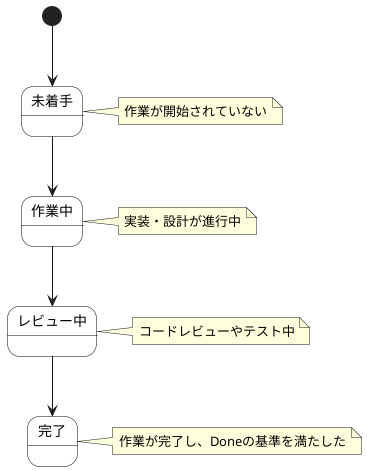

# Sprint Backlog項目 ステートチャート

Sprint Backlog項目情報の状態遷移を示します。

## 状態一覧

| 状態ID | 状態名 | 説明 |
|--------|--------|------|
| ST-SP-05 | 未着手 | 作業が開始されていない |
| ST-SP-06 | 作業中 | 実装・設計が進行中 |
| ST-SP-07 | レビュー中 | コードレビューやテスト中 |
| ST-SP-08 | 完了 | 作業が完了し、Doneの基準を満たした |
