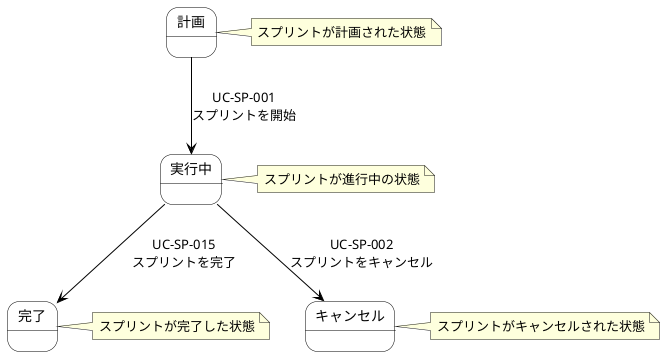
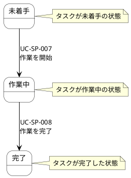

# AG-04 スプリント実行 ステートマシン図

## スプリントの状態遷移

## タスクの状態遷移

## 状態一覧

| 状態モデル | 状態名 | 説明 | 遷移元 | 遷移先 | トリガーUC |
|-----------|--------|------|--------|--------|-----------|
| スプリント | 計画 | スプリントが計画された状態 | - | 実行中 | UC-SP-001 |
| スプリント | 実行中 | スプリントが進行中の状態 | 計画 | 完了, キャンセル | UC-SP-015, UC-SP-002 |
| スプリント | 完了 | スプリントが完了した状態 | 実行中 | - | - |
| スプリント | キャンセル | スプリントがキャンセルされた状態 | 実行中 | - | - |
| タスク | 未着手 | タスクが未着手の状態 | - | 作業中 | UC-SP-007 |
| タスク | 作業中 | タスクが作業中の状態 | 未着手 | 完了 | UC-SP-008 |
| タスク | 完了 | タスクが完了した状態 | 作業中 | - | - |
