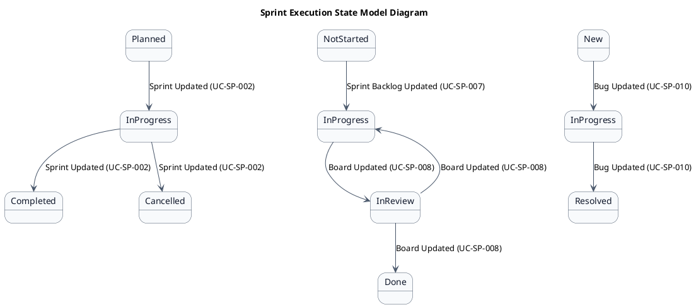
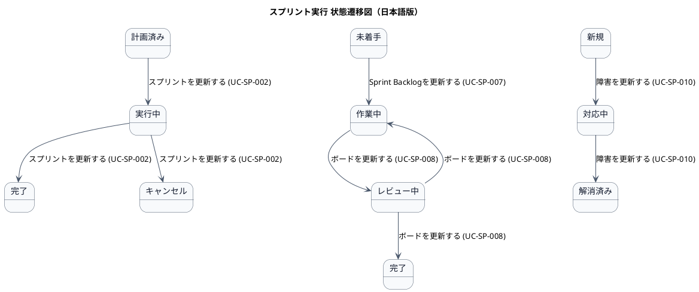

# ステートマシン図

スプリント実行業務領域で扱う情報の状態遷移を示す状態モデル図です。

## 1. 目的

本書は、AG-04 スプリント実行業務領域のシステムレイヤーで扱う情報の状態遷移を示す状態モデル図（ステートマシン図）です。

## 2. PlantUML 状態遷移図（英語版）

## 3. 日本語版 状態遷移図

## 4. 状態一覧

| 状態名 (ID)       | 英語名        | 対象情報         | 説明                                     |
|-------------------|---------------|------------------|------------------------------------------|
| 計画済み (ST-SP-01) | Planned     | スプリント       | スプリントが作成され、計画が完了した     |
| 実行中 (ST-SP-02)  | InProgress  | スプリント       | スプリントが進行中                       |
| 完了 (ST-SP-03)    | Completed   | スプリント       | スプリントが終了し、成果が確認された     |
| キャンセル (ST-SP-04) | Cancelled | スプリント       | スプリントが中止された                   |
| 未着手 (ST-SP-05)  | NotStarted  | Sprint Backlog項目 | 作業が開始されていない                 |
| 作業中 (ST-SP-06)  | InProgress  | Sprint Backlog項目 | 実装・設計が進行中                     |
| レビュー中 (ST-SP-07) | InReview  | Sprint Backlog項目 | コードレビューやテスト中               |
| 完了 (ST-SP-08)    | Done        | Sprint Backlog項目 | 作業が完了し、Doneの基準を満たした       |
| 新規 (ST-SP-09)    | New         | 障害             | 報告されたが、まだ対応されていない       |
| 対応中 (ST-SP-10)  | InProgress  | 障害             | 解消のための対応が進行中                 |
| 解消済み (ST-SP-11) | Resolved   | 障害             | 障害が解消された                         |

## 5. 遷移一覧

| 遷移ID | 元状態       | 遷移先状態 | トリガー                          | 関連ユースケース              | 説明                                     |
|--------|--------------|------------|-----------------------------------|-------------------------------|------------------------------------------|
| TR-SP-01 | 計画済み  | 実行中     | スプリントを更新する (UC-SP-002)   | UC-SP-002                    | スプリントが開始された                   |
| TR-SP-02 | 実行中    | 完了       | スプリントを更新する (UC-SP-002)   | UC-SP-002                    | スプリントが終了し、成果が確認された     |
| TR-SP-03 | 実行中    | キャンセル | スプリントを更新する (UC-SP-002)   | UC-SP-002                    | スプリントが中止された                   |
| TR-SP-04 | 未着手    | 作業中     | Sprint Backlogを更新する (UC-SP-007) | UC-SP-007                   | 作業が開始された                         |
| TR-SP-05 | 作業中    | レビュー中 | ボードを更新する (UC-SP-008)        | UC-SP-008                    | コードレビューやテストが開始された       |
| TR-SP-06 | レビュー中 | 完了      | ボードを更新する (UC-SP-008)        | UC-SP-008                    | 作業が完了し、Doneの基準を満たした       |
| TR-SP-07 | レビュー中 | 作業中    | ボードを更新する (UC-SP-008)        | UC-SP-008                    | レビューで不具合が見つかり、再作業が必要 |
| TR-SP-08 | 新規      | 対応中     | 障害を更新する (UC-SP-010)          | UC-SP-010                    | 障害の対応が開始された                   |
| TR-SP-09 | 対応中    | 解消済み   | 障害を更新する (UC-SP-010)          | UC-SP-010                    | 障害が解消された                         |

## 6. 参照情報

- ステート一覧: `02.ステート/ステート一覧.tsv`
- 関連ユースケース: `03.システム境界/01.ユースケース/ユースケース一覧.md`
