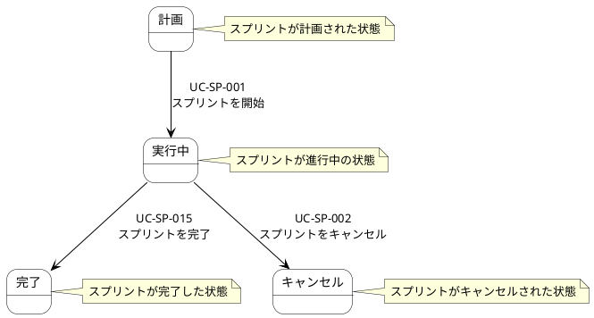

# ステートマシン図 - スプリント

スプリントの状態遷移をPlantUMLで視覚化します。

## 状態遷移図

## 状態一覧

| 状態名     | 説明                             | 遷移元 | 遷移先           | トリガーUC           |
|------------|----------------------------------|--------|------------------|----------------------|
| 計画       | スプリントが計画された状態       | -      | 実行中           | UC-SP-001            |
| 実行中     | スプリントが進行中の状態         | 計画   | 完了, キャンセル | UC-SP-015, UC-SP-002 |
| 完了       | スプリントが完了した状態         | 実行中 | -                | -                    |
| キャンセル | スプリントがキャンセルされた状態 | 実行中 | -                | -                    |
