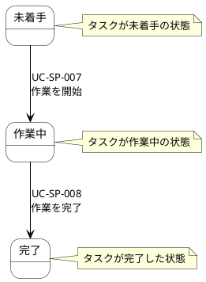

# ステートマシン図 - タスク

タスクの状態遷移をPlantUMLで視覚化します。

## 状態遷移図

## 状態一覧

| 状態名 | 説明                 | 遷移元 | 遷移先 | トリガーUC |
|--------|----------------------|--------|--------|------------|
| 未着手 | タスクが未着手の状態 | -      | 作業中 | UC-SP-007  |
| 作業中 | タスクが作業中の状態 | 未着手 | 完了   | UC-SP-008  |
| 完了   | タスクが完了した状態 | 作業中 | -      | -          |
