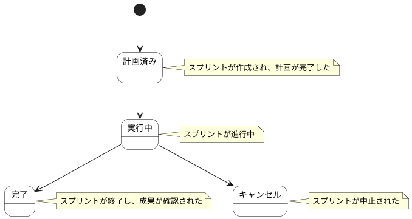

# スプリント ステートチャート

スプリント情報の状態遷移を示します。

## 状態一覧

| 状態ID | 状態名 | 説明 |
|--------|--------|------|
| ST-SP-01 | 計画済み | スプリントが作成され、計画が完了した |
| ST-SP-02 | 実行中 | スプリントが進行中 |
| ST-SP-03 | 完了 | スプリントが終了し、成果が確認された |
| ST-SP-04 | キャンセル | スプリントが中止された |
