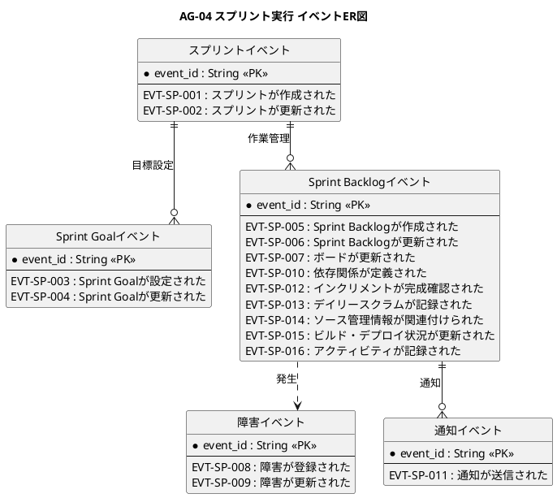

# イベントER図

スプリント実行業務領域で発生するドメインイベントの関係を示すER図です。

## 1. 目的

本書は、AG-04 スプリント実行業務領域のシステムレイヤーで発生するドメインイベント間の関係を示すER図です。

## 2. PlantUML ER図



## 3. 日本語版 ER図

```plantuml
@startuml
title AG-04 スプリント実行 イベントER図（日本語版）
hide circle
skinparam linetype ortho
skinparam shadowing false
skinparam entity {
  BackgroundColor #F8FAFC
  BorderColor #475569
  FontColor #0F172A
}
skinparam packageStyle rectangle

entity "スプリントイベント" as SprintEvents {
  * イベントID : String <<PK>>
  --
  EVT-SP-001 : スプリントが作成された
  EVT-SP-002 : スプリントが更新された
}

entity "Sprint Goalイベント" as SprintGoalEvents {
  * イベントID : String <<PK>>
  --
  EVT-SP-003 : Sprint Goalが設定された
  EVT-SP-004 : Sprint Goalが更新された
}

entity "Sprint Backlogイベント" as SprintBacklogEvents {
  * イベントID : String <<PK>>
  --
  EVT-SP-005 : Sprint Backlogが作成された
  EVT-SP-006 : Sprint Backlogが更新された
  EVT-SP-007 : ボードが更新された
  EVT-SP-010 : 依存関係が定義された
  EVT-SP-012 : インクリメントが完成確認された
  EVT-SP-013 : デイリースクラムが記録された
  EVT-SP-014 : ソース管理情報が関連付けられた
  EVT-SP-015 : ビルド・デプロイ状況が更新された
  EVT-SP-016 : アクティビティが記録された
}

entity "障害イベント" as ImpedimentEvents {
  * イベントID : String <<PK>>
  --
  EVT-SP-008 : 障害が登録された
  EVT-SP-009 : 障害が更新された
}

entity "通知イベント" as NotificationEvents {
  * イベントID : String <<PK>>
  --
  EVT-SP-011 : 通知が送信された
}

' スプリントからSprint Goalへ
スプリントイベント ||--o{ Sprint Goalイベント : 目標設定

' スプリントからSprint Backlogへ
スプリントイベント ||--o{ Sprint Backlogイベント : 作業管理

' Sprint Backlogから障害へ
Sprint Backlogイベント ..> 障害イベント : 発生

' Sprint Backlogから通知へ
Sprint Backlogイベント ||--o{ 通知イベント : 通知

@enduml
```

## 4. イベントエンティティ一覧

| イベントエンティティ     | イベントID  | イベント名                             | 関連情報   | 集約               |
|--------------------------|-------------|----------------------------------------|------------|--------------------|
| SprintEvents             | EVT-SP-001  | スプリントが作成された                 | INF-SP-01  | スプリント         |
| SprintEvents             | EVT-SP-002  | スプリントが更新された                 | INF-SP-01  | スプリント         |
| SprintGoalEvents         | EVT-SP-003  | Sprint Goalが設定された                | INF-SP-02  | Sprint Goal        |
| SprintGoalEvents         | EVT-SP-004  | Sprint Goalが更新された                | INF-SP-02  | Sprint Goal        |
| SprintBacklogEvents      | EVT-SP-005  | Sprint Backlogが作成された             | INF-SP-03  | Sprint Backlog項目 |
| SprintBacklogEvents      | EVT-SP-006  | Sprint Backlogが更新された             | INF-SP-03  | Sprint Backlog項目 |
| SprintBacklogEvents      | EVT-SP-007  | ボードが更新された                     | INF-SP-03  | Sprint Backlog項目 |
| SprintBacklogEvents      | EVT-SP-010  | 依存関係が定義された                   | INF-SP-05  | Sprint Backlog項目 |
| SprintBacklogEvents      | EVT-SP-012  | インクリメントが完成確認された         | INF-SP-03  | Sprint Backlog項目 |
| SprintBacklogEvents      | EVT-SP-013  | デイリースクラムが記録された           | INF-SP-03  | Sprint Backlog項目 |
| SprintBacklogEvents      | EVT-SP-014  | ソース管理情報が関連付けられた         | INF-SP-03  | Sprint Backlog項目 |
| SprintBacklogEvents      | EVT-SP-015  | ビルド・デプロイ状況が更新された       | INF-SP-03  | Sprint Backlog項目 |
| SprintBacklogEvents      | EVT-SP-016  | アクティビティが記録された             | INF-SP-07  | Sprint Backlog項目 |
| ImpedimentEvents         | EVT-SP-008  | 障害が登録された                       | INF-SP-04  | 障害               |
| ImpedimentEvents         | EVT-SP-009  | 障害が更新された                       | INF-SP-04  | 障害               |
| NotificationEvents       | EVT-SP-011  | 通知が送信された                       | INF-SP-06  | 通知               |

## 5. 主要な関係

- **スプリントイベント → Sprint Goalイベント**：スプリント目標の設定
- **スプリントイベント → Sprint Backlogイベント**：作業の管理
- **Sprint Backlogイベント → 障害イベント**：作業中の障害発生
- **Sprint Backlogイベント → 通知イベント**：作業状況の通知
