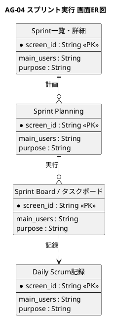

# 画面ER図

スプリント実行業務領域が提供する画面の関係を示すER図です。

## 1. 目的

本書は、AG-04 スプリント実行業務領域のシステムレイヤーで提供する画面エンティティ間の関係を示すER図です。

## 2. PlantUML ER図



## 3. 日本語版 ER図

```plantuml
@startuml
title AG-04 スプリント実行 画面ER図（日本語版）
hide circle
skinparam linetype ortho
skinparam shadowing false
skinparam entity {
  BackgroundColor #F8FAFC
  BorderColor #475569
  FontColor #0F172A
}
skinparam packageStyle rectangle

entity "Sprint一覧・詳細" as SprintList {
  * 画面ID : String <<PK>>
  --
  主な利用者 : String
  画面の目的 : String
}

entity "Sprint Planning" as SprintPlanning {
  * 画面ID : String <<PK>>
  --
  主な利用者 : String
  画面の目的 : String
}

entity "Sprint Board / タスクボード" as SprintBoard {
  * 画面ID : String <<PK>>
  --
  主な利用者 : String
  画面の目的 : String
}

entity "Daily Scrum記録" as DailyScrum {
  * 画面ID : String <<PK>>
  --
  主な利用者 : String
  画面の目的 : String
}

' Sprint一覧からSprint Planningへ
Sprint一覧・詳細 ||--o{ Sprint Planning : 計画

' Sprint PlanningからSprint Boardへ
Sprint Planning ||--o{ Sprint Board / タスクボード : 実行

' Sprint BoardからDaily Scrumへ
Sprint Board / タスクボード ..> Daily Scrum記録 : 記録

@enduml
```

## 4. 画面エンティティ一覧

| 画面エンティティ | 画面ID  | 画面名                 | 主な利用者     | 画面の目的                                               |
|------------------|---------|------------------------|----------------|----------------------------------------------------------|
| SprintList       | SCR-013 | Sprint一覧・詳細       | 全チーム       | Sprint期間、目標、選択Story、状態を確認する              |
| SprintPlanning   | SCR-014 | Sprint Planning        | PO、SM、開発者 | Sprint Goal、バックログ選択、容量・ベロシティ、タスク分解を協働で決める |
| SprintBoard      | SCR-015 | Sprint Board / タスクボード | 開発者、SM、PO | Story・Taskの状態、作業中項目、ブロッカーを更新・確認する |
| DailyScrum       | SCR-016 | Daily Scrum記録        | 開発者、SM     | Sprint Goalに向けた状況、障害、計画調整を記録する        |

## 5. 主要な関係

- **Sprint一覧・詳細 → Sprint Planning**：スプリントの計画立案
- **Sprint Planning → Sprint Board / タスクボード**：計画に基づく実行
- **Sprint Board / タスクボード → Daily Scrum記録**：日々の進捗記録
