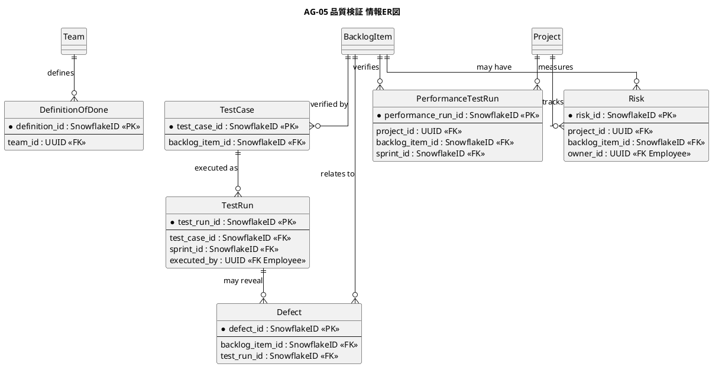
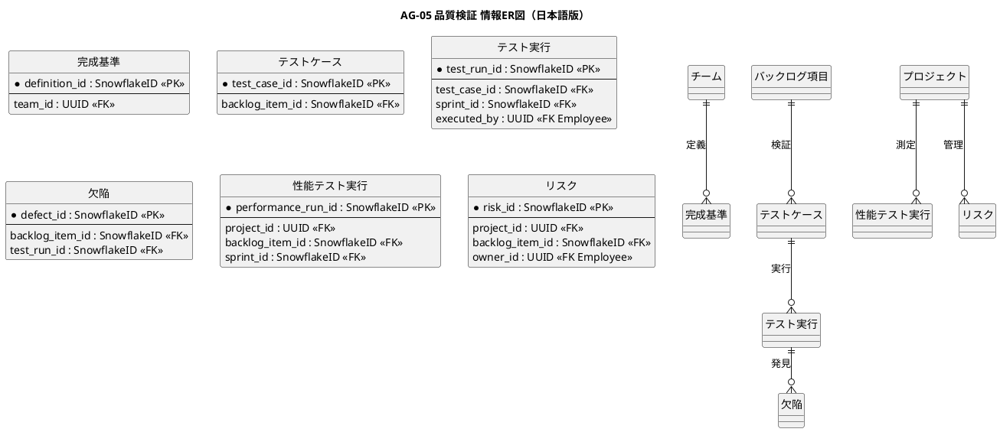

# 情報ER図

プロダクト品質・受入・性能検証業務領域で扱う情報の関係を示すER図です。

## 1. 目的

本書は、AG-05 品質検証業務領域のシステムレイヤーで扱う情報エンティティ間の関係を示すER図です。

## 2. PlantUML ER図

## 3. 日本語版 ER図

## 4. エンティティ一覧

| エンティティ       | 情報名 (ID)                          | 説明                                   |
|--------------------|--------------------------------------|----------------------------------------|
| DefinitionOfDone   | Definition of Done (INF-QL-01)       | チームの完成基準                       |
| TestCase           | テストケース (INF-QL-02)             | 要求や受入条件に関連づけたテストケース |
| TestRun            | テスト実行結果 (INF-QL-03)           | 手動・自動テストの実行結果             |
| Defect             | 欠陥 (INF-QL-04)                     | 再現手順、影響度、状態                 |
| PerformanceTestRun | 性能テスト結果 (INF-QL-06)           | 性能テストの実行結果                   |
| Risk               | セキュリティ・品質リスク (INF-QL-07) | 品質・セキュリティ上のリスクと対応     |

## 5. 主要な関係

- **Team → DefinitionOfDone**：チームが合意した完成基準（版管理）
- **BacklogItem → TestCase**：バックログ項目に対するテストケース（テストケースと項目: INF-QL-08）
- **TestCase → TestRun**：テストケースの実行結果
- **TestRun → Defect**：テスト実行で見つかった欠陥（欠陥と項目: INF-QL-09）
- **BacklogItem → Defect**：項目に関連する欠陥
- **Project → PerformanceTestRun**：プロジェクトの性能テスト
- **Project → Risk**：プロジェクトのリスク管理

## 6. 参照エンティティ

以下のエンティティは他の業務領域で定義され、参照として使用されます。

| エンティティ | 所属業務領域 | 説明           |
|--------------|--------------|----------------|
| Team         | 共通         | 開発チーム     |
| BacklogItem  | AG-02        | バックログ項目 |
| Sprint       | AG-04        | スプリント     |
| Employee     | 共通         | 従業員         |
| Project      | 共通         | プロジェクト   |
