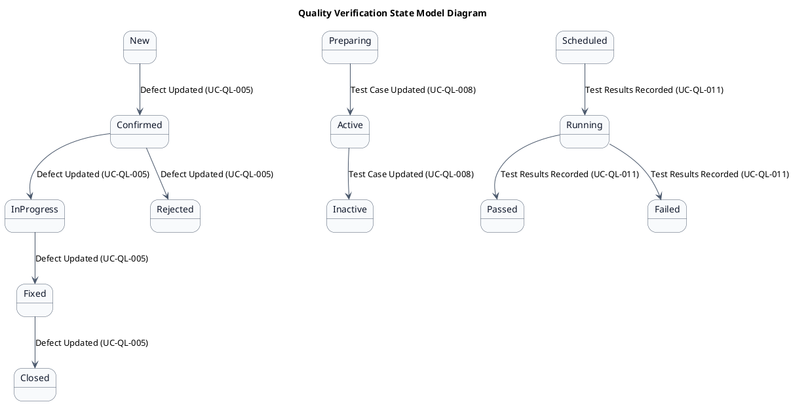
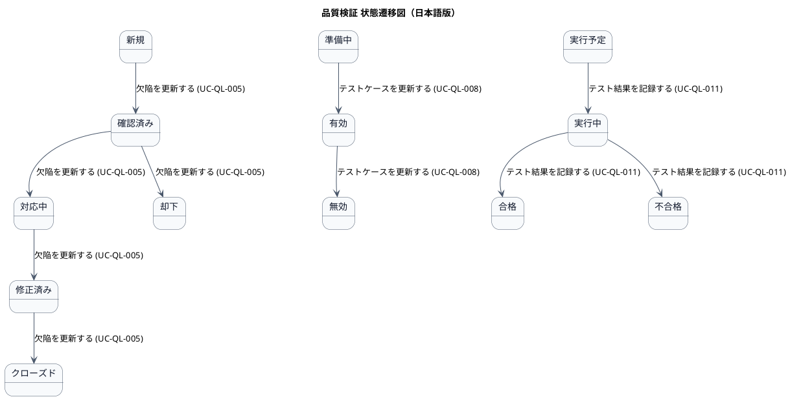

# ステートマシン図

品質検証業務領域で扱う情報の状態遷移を示す状態モデル図です。

## 1. 目的

本書は、AG-05 品質検証業務領域のシステムレイヤーで扱う情報の状態遷移を示す状態モデル図（ステートマシン図）です。

## 2. PlantUML 状態遷移図（英語版）

## 3. 日本語版 状態遷移図

## 4. 状態一覧

| 状態名 (ID)       | 英語名        | 対象情報         | 説明                                     |
|-------------------|---------------|------------------|------------------------------------------|
| 新規 (ST-QL-01)   | New           | 欠陥             | 報告されたが、まだ確認されていない       |
| 確認済み (ST-QL-02) | Confirmed   | 欠陥             | 再現性が確認され、対応が決定された       |
| 対応中 (ST-QL-03)  | InProgress   | 欠陥             | 修正作業が進行中                         |
| 修正済み (ST-QL-04) | Fixed       | 欠陥             | 修正が完了し、検証待ち                   |
| クローズド (ST-QL-05) | Closed    | 欠陥             | 修正が検証され、完了した                 |
| 却下 (ST-QL-06)   | Rejected      | 欠陥             | 欠陥ではないと判断された                 |
| 準備中 (ST-QL-07)  | Preparing    | テストケース     | 作成中またはレビュー中                   |
| 有効 (ST-QL-08)   | Active        | テストケース     | 実行可能な状態                           |
| 無効 (ST-QL-09)   | Inactive      | テストケース     | 不要になったまたは古いテストケース       |
| 実行予定 (ST-QL-10) | Scheduled   | テスト実行結果   | テストが計画されたが、まだ実行されていない |
| 実行中 (ST-QL-11)  | Running      | テスト実行結果   | テスト実行が進行中                       |
| 合格 (ST-QL-12)   | Passed        | テスト実行結果   | テストが合格した                         |
| 不合格 (ST-QL-13)  | Failed       | テスト実行結果   | テストが不合格だった                     |

## 5. 遷移一覧

| 遷移ID | 元状態       | 遷移先状態 | トリガー                          | 関連ユースケース              | 説明                                     |
|--------|--------------|------------|-----------------------------------|-------------------------------|------------------------------------------|
| TR-QL-01 | 新規      | 確認済み   | 欠陥を更新する (UC-QL-005)         | UC-QL-005                    | 再現性が確認され、対応が決定された       |
| TR-QL-02 | 確認済み  | 対応中     | 欠陥を更新する (UC-QL-005)         | UC-QL-005                    | 修正作業が開始された                     |
| TR-QL-03 | 対応中    | 修正済み   | 欠陥を更新する (UC-QL-005)         | UC-QL-005                    | 修正が完了し、検証待ち                   |
| TR-QL-04 | 修正済み  | クローズド | 欠陥を更新する (UC-QL-005)         | UC-QL-005                    | 修正が検証され、完了した                 |
| TR-QL-05 | 確認済み  | 却下       | 欠陥を更新する (UC-QL-005)         | UC-QL-005                    | 欠陥ではないと判断された                 |
| TR-QL-06 | 準備中    | 有効       | テストケースを更新する (UC-QL-008) | UC-QL-008                    | テストケースが実行可能な状態になった     |
| TR-QL-07 | 有効      | 無効       | テストケースを更新する (UC-QL-008) | UC-QL-008                    | テストケースが不要になった               |
| TR-QL-08 | 実行予定  | 実行中     | テスト結果を記録する (UC-QL-011)   | UC-QL-011                    | テスト実行が開始された                   |
| TR-QL-09 | 実行中    | 合格       | テスト結果を記録する (UC-QL-011)   | UC-QL-011                    | テストが合格した                         |
| TR-QL-10 | 実行中    | 不合格     | テスト結果を記録する (UC-QL-011)   | UC-QL-011                    | テストが不合格だった                     |

## 6. 参照情報

- ステート一覧: `02.ステート/ステート一覧.tsv`
- 関連ユースケース: `03.システム境界/01.ユースケース/ユースケース一覧.md`
