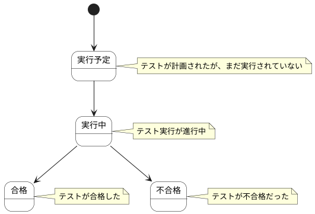

# テスト実行結果 ステートチャート

テスト実行結果情報の状態遷移を示します。

## 状態一覧

| 状態ID | 状態名 | 説明 |
|--------|--------|------|
| ST-QL-10 | 実行予定 | テストが計画されたが、まだ実行されていない |
| ST-QL-11 | 実行中 | テスト実行が進行中 |
| ST-QL-12 | 合格 | テストが合格した |
| ST-QL-13 | 不合格 | テストが不合格だった |
