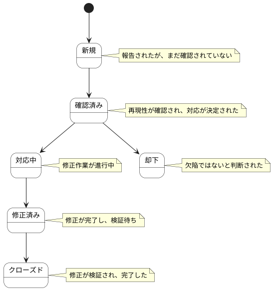

# 欠陥 ステートチャート

欠陥情報の状態遷移を示します。

## 状態一覧

| 状態ID | 状態名 | 説明 |
|--------|--------|------|
| ST-QL-01 | 新規 | 報告されたが、まだ確認されていない |
| ST-QL-02 | 確認済み | 再現性が確認され、対応が決定された |
| ST-QL-03 | 対応中 | 修正作業が進行中 |
| ST-QL-04 | 修正済み | 修正が完了し、検証待ち |
| ST-QL-05 | クローズド | 修正が検証され、完了した |
| ST-QL-06 | 却下 | 欠陥ではないと判断された |
