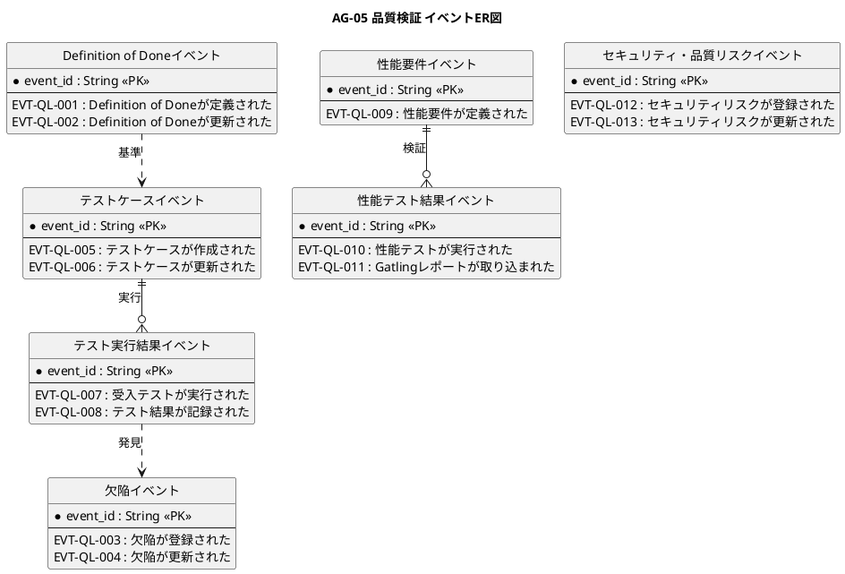

# イベントER図

品質検証業務領域で発生するドメインイベントの関係を示すER図です。

## 1. 目的

本書は、AG-05 品質検証業務領域のシステムレイヤーで発生するドメインイベント間の関係を示すER図です。

## 2. PlantUML ER図



## 3. 日本語版 ER図

```plantuml
@startuml
title AG-05 品質検証 イベントER図（日本語版）
hide circle
skinparam linetype ortho
skinparam shadowing false
skinparam entity {
  BackgroundColor #F8FAFC
  BorderColor #475569
  FontColor #0F172A
}
skinparam packageStyle rectangle

entity "Definition of Doneイベント" as DoDEvents {
  * イベントID : String <<PK>>
  --
  EVT-QL-001 : Definition of Doneが定義された
  EVT-QL-002 : Definition of Doneが更新された
}

entity "テストケースイベント" as TestCaseEvents {
  * イベントID : String <<PK>>
  --
  EVT-QL-005 : テストケースが作成された
  EVT-QL-006 : テストケースが更新された
}

entity "テスト実行結果イベント" as TestResultEvents {
  * イベントID : String <<PK>>
  --
  EVT-QL-007 : 受入テストが実行された
  EVT-QL-008 : テスト結果が記録された
}

entity "欠陥イベント" as DefectEvents {
  * イベントID : String <<PK>>
  --
  EVT-QL-003 : 欠陥が登録された
  EVT-QL-004 : 欠陥が更新された
}

entity "性能要件イベント" as PerfRequirementEvents {
  * イベントID : String <<PK>>
  --
  EVT-QL-009 : 性能要件が定義された
}

entity "性能テスト結果イベント" as PerfTestResultEvents {
  * イベントID : String <<PK>>
  --
  EVT-QL-010 : 性能テストが実行された
  EVT-QL-011 : Gatlingレポートが取り込まれた
}

entity "セキュリティ・品質リスクイベント" as SecurityRiskEvents {
  * イベントID : String <<PK>>
  --
  EVT-QL-012 : セキュリティリスクが登録された
  EVT-QL-013 : セキュリティリスクが更新された
}

' Definition of Doneからテストケースへ
Definition of Doneイベント ..> テストケースイベント : 基準

' テストケースからテスト実行結果へ
テストケースイベント ||--o{ テスト実行結果イベント : 実行

' テスト実行結果から欠陥へ
テスト実行結果イベント ..> 欠陥イベント : 発見

' 性能要件から性能テスト結果へ
性能要件イベント ||--o{ 性能テスト結果イベント : 検証

@enduml
```

## 4. イベントエンティティ一覧

| イベントエンティティ       | イベントID  | イベント名                             | 関連情報   | 集約                   |
|----------------------------|-------------|----------------------------------------|------------|------------------------|
| DoDEvents                  | EVT-QL-001  | Definition of Doneが定義された         | INF-QL-01  | Definition of Done     |
| DoDEvents                  | EVT-QL-002  | Definition of Doneが更新された         | INF-QL-01  | Definition of Done     |
| TestCaseEvents             | EVT-QL-005  | テストケースが作成された               | INF-QL-02  | テストケース           |
| TestCaseEvents             | EVT-QL-006  | テストケースが更新された               | INF-QL-02  | テストケース           |
| TestResultEvents           | EVT-QL-007  | 受入テストが実行された                 | INF-QL-03  | テスト実行結果         |
| TestResultEvents           | EVT-QL-008  | テスト結果が記録された                 | INF-QL-03  | テスト実行結果         |
| DefectEvents               | EVT-QL-003  | 欠陥が登録された                       | INF-QL-04  | 欠陥                   |
| DefectEvents               | EVT-QL-004  | 欠陥が更新された                       | INF-QL-04  | 欠陥                   |
| PerfRequirementEvents      | EVT-QL-009  | 性能要件が定義された                   | INF-QL-05  | 性能要件               |
| PerfTestResultEvents       | EVT-QL-010  | 性能テストが実行された                 | INF-QL-06  | 性能テスト結果         |
| PerfTestResultEvents       | EVT-QL-011  | Gatlingレポートが取り込まれた          | INF-QL-06  | 性能テスト結果         |
| SecurityRiskEvents         | EVT-QL-012  | セキュリティリスクが登録された         | INF-QL-07  | セキュリティ・品質リスク |
| SecurityRiskEvents         | EVT-QL-013  | セキュリティリスクが更新された         | INF-QL-07  | セキュリティ・品質リスク |

## 5. 主要な関係

- **Definition of Doneイベント → テストケースイベント**：完成基準に基づくテストケース定義
- **テストケースイベント → テスト実行結果イベント**：テストケースの実行
- **テスト実行結果イベント → 欠陥イベント**：テストによる欠陥発見
- **性能要件イベント → 性能テスト結果イベント**：性能要件の検証
