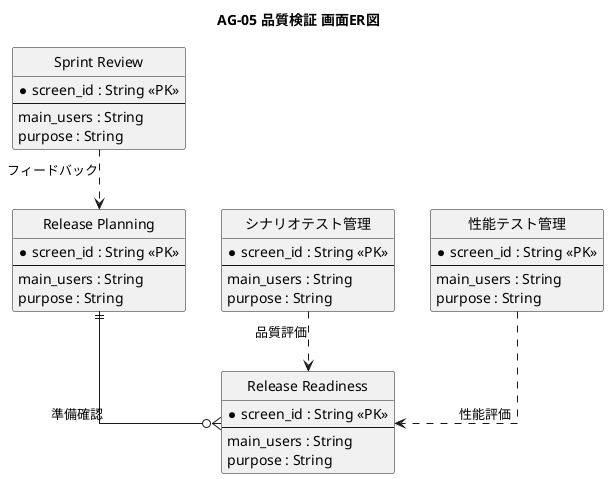

# 画面ER図

品質検証業務領域が提供する画面の関係を示すER図です。

## 1. 目的

本書は、AG-05 品質検証業務領域のシステムレイヤーで提供する画面エンティティ間の関係を示すER図です。

## 2. PlantUML ER図



## 3. 日本語版 ER図

```plantuml
@startuml
title AG-05 品質検証 画面ER図（日本語版）
hide circle
skinparam linetype ortho
skinparam shadowing false
skinparam entity {
  BackgroundColor #F8FAFC
  BorderColor #475569
  FontColor #0F172A
}
skinparam packageStyle rectangle

entity "Sprint Review" as SprintReview {
  * 画面ID : String <<PK>>
  --
  主な利用者 : String
  画面の目的 : String
}

entity "Release Planning" as ReleasePlanning {
  * 画面ID : String <<PK>>
  --
  主な利用者 : String
  画面の目的 : String
}

entity "Release Readiness" as ReleaseReadiness {
  * 画面ID : String <<PK>>
  --
  主な利用者 : String
  画面の目的 : String
}

entity "シナリオテスト管理" as ScenarioTest {
  * 画面ID : String <<PK>>
  --
  主な利用者 : String
  画面の目的 : String
}

entity "性能テスト管理" as PerfTest {
  * 画面ID : String <<PK>>
  --
  主な利用者 : String
  画面の目的 : String
}

' Release PlanningからRelease Readinessへ
Release Planning ||--o{ Release Readiness : 準備確認

' シナリオテスト管理からRelease Readinessへ
シナリオテスト管理 ..> Release Readiness : 品質評価

' 性能テスト管理からRelease Readinessへ
性能テスト管理 ..> Release Readiness : 性能評価

' Sprint ReviewからRelease Planningへ
Sprint Review ..> Release Planning : フィードバック

@enduml
```

## 4. 画面エンティティ一覧

| 画面エンティティ   | 画面ID  | 画面名             | 主な利用者               | 画面の目的                                               |
|--------------------|---------|--------------------|--------------------------|----------------------------------------------------------|
| SprintReview       | SCR-017 | Sprint Review      | PO、チーム、ステークホルダー | 成果を確認し、フィードバックとバックログ候補を記録する   |
| ReleasePlanning    | SCR-018 | Release Planning   | PO、開発チーム、関係者   | Release範囲、マイルストーン、依存関係、予測、リスクを管理する |
| ReleaseReadiness   | SCR-019 | Release Readiness  | PO、品質担当、リリース責任者 | 品質・性能・運用・依存関係などのリリース準備状況を評価する |
| ScenarioTest       | SCR-020 | シナリオテスト管理 | テスト担当、PO、開発者   | 複数Storyを横断する業務シナリオ、手順、実行履歴を管理する |
| PerfTest           | SCR-021 | 性能テスト管理     | 開発者、性能担当、PO     | 性能要件、負荷プロファイル、実行、測定結果、評価を管理する |

## 5. 主要な関係

- **Release Planning → Release Readiness**：リリース計画に基づく準備状況の確認
- **シナリオテスト管理 → Release Readiness**：テスト結果に基づく品質評価
- **性能テスト管理 → Release Readiness**：性能テスト結果に基づく性能評価
- **Sprint Review → Release Planning**：フィードバックに基づくリリース計画の更新
