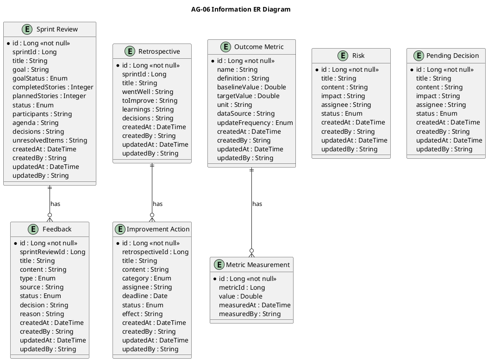
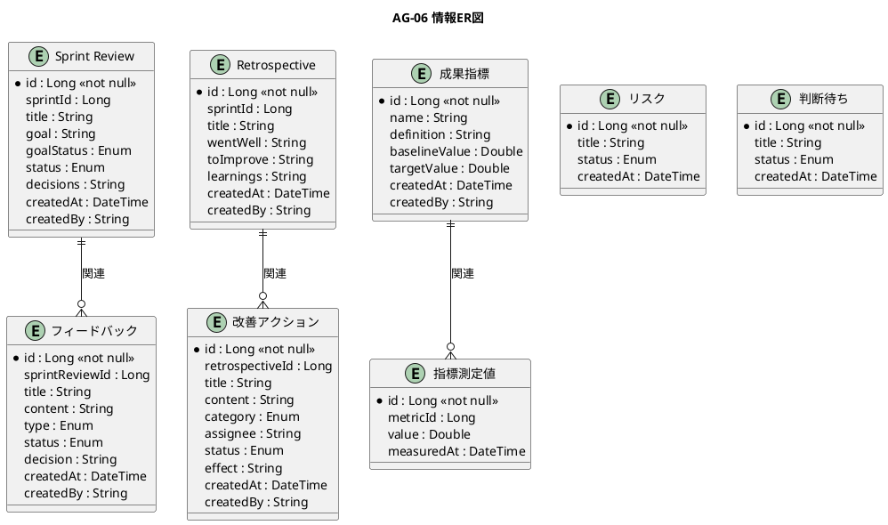

# 情報ER図

成果計測・フィードバックによる適応業務領域（AG-06）のER図をPlantUMLで定義します。

## 英語版

## 日本語版

## 情報一覧

| 番号 | 情報名 | 情報種類 |
|------|--------|----------|
| 1 | Sprint Review | リソース |
| 2 | フィードバック | リソース |
| 3 | フィードバック対応 | 対応表 |
| 4 | Retrospective | リソース |
| 5 | 改善アクション | リソース |
| 6 | リリース履歴 | リソース |
| 7 | 成果指標 | リソース |
| 8 | 指標測定値 | イベント |
| 9 | リスク | リソース |
| 10 | 判断待ち | リソース |
| 11 | ダッシュボード設定 | リソース |
| 12 | レポート出力履歴 | イベント |
| 13 | フィードバック種別 | 対照表 |
| 14 | 改善カテゴリ | 対照表 |

## 関係一覧

| 源情報 | 対象情報 | 関係 | 多重度 |
|--------|----------|------|--------|
| Sprint Review | フィードバック | 1:N | 1つのReviewに複数のフィードバック |
| Retrospective | 改善アクション | 1:N | 1つの振り返りに複数の改善アクション |
| 成果指標 | 指標測定値 | 1:N | 1つの指標に複数の測定値 |
| フィードバック | フィードバック対応 | 1:N | 1つのフィードバックに複数の対応 |
