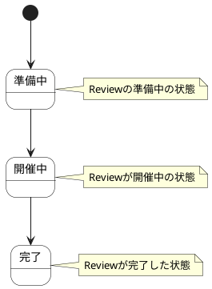

# Sprint Review ステートチャート

Sprint Review情報の状態遷移を示します。

## 状態一覧

| 状態ID | 状態名 | 説明 |
|--------|--------|------|
| ST-MF-005 | 準備中 | Reviewの準備中の状態 |
| ST-MF-006 | 開催中 | Reviewが開催中の状態 |
| ST-MF-007 | 完了 | Reviewが完了した状態 |
