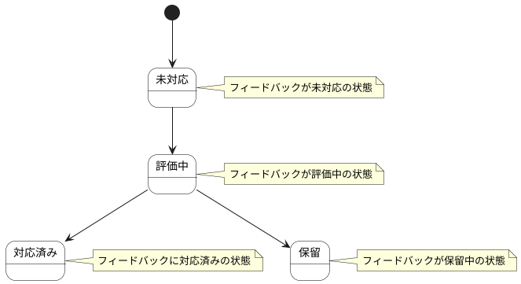

# フィードバック ステートチャート

フィードバック情報の状態遷移を示します。

## 状態一覧

| 状態ID | 状態名 | 説明 |
|--------|--------|------|
| ST-MF-008 | 未対応 | フィードバックが未対応の状態 |
| ST-MF-009 | 評価中 | フィードバックが評価中の状態 |
| ST-MF-010 | 対応済み | フィードバックに対応済みの状態 |
| ST-MF-011 | 保留 | フィードバックが保留中の状態 |
