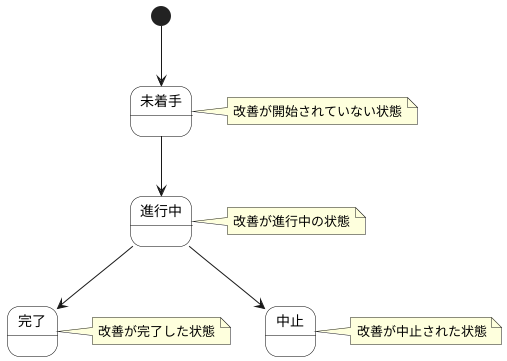

# 改善アクション ステートチャート

改善アクション情報の状態遷移を示します。

## 状態一覧

| 状態ID | 状態名 | 説明 |
|--------|--------|------|
| ST-MF-001 | 未着手 | 改善が開始されていない状態 |
| ST-MF-002 | 進行中 | 改善が進行中の状態 |
| ST-MF-003 | 完了 | 改善が完了した状態 |
| ST-MF-004 | 中止 | 改善が中止された状態 |
