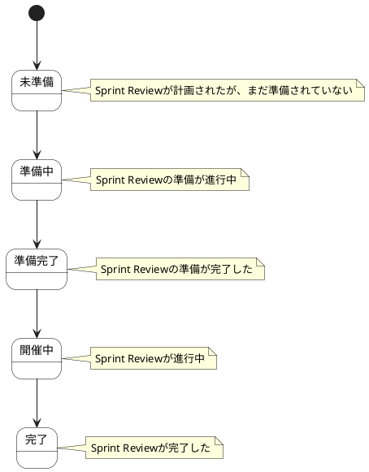

# Sprint Review ステートチャート

Sprint Review情報の状態遷移を示します。

## 状態一覧

| 状態ID | 状態名 | 説明 |
|--------|--------|------|
| ST-SR-01 | 未準備 | Sprint Reviewが計画されたが、まだ準備されていない |
| ST-SR-02 | 準備中 | Sprint Reviewの準備が進行中 |
| ST-SR-03 | 準備完了 | Sprint Reviewの準備が完了した |
| ST-SR-04 | 開催中 | Sprint Reviewが進行中 |
| ST-SR-05 | 完了 | Sprint Reviewが完了した |
