# ステートマシン図

成果適応業務領域で扱う情報の状態遷移を示す状態モデル図です。

## 1. 目的

本書は、AG-06 成果適応業務領域のシステムレイヤーで扱う情報の状態遷移を示す状態モデル図（ステートマシン図）です。

## 2. PlantUML 状態遷移図（英語版）

```plantuml
@startuml
title Outcome Adaptation State Model Diagram
skinparam state {
  BackgroundColor #F8FAFC
  BorderColor #475569
  FontColor #0F172A
}
skinparam arrowColor #475569
skinparam shadowing false

' Improvement Action states
state "NotStarted" as NotStarted_IA <<entry>>
state "InProgress" as InProgress_IA
state "Completed" as Completed_IA <<exit>>
state "EffectVerifying" as EffectVerifying_IA
state "EffectConfirmed" as EffectConfirmed_IA <<exit>>

' Risk states
state "New" as New_RK <<entry>>
state "InProgress" as InProgress_RK
state "Resolved" as Resolved_RK <<exit>>
state "Accepted" as Accepted_RK <<exit>>

' User Review states
state "Planned" as Planned_UR <<entry>>
state "InProgress" as InProgress_UR
state "Completed" as Completed_UR <<exit>>

' Sprint Review states
state "NotPrepared" as NotPrepared_SR <<entry>>
state "Preparing" as Preparing_SR
state "Prepared" as Prepared_SR
state "InProgress" as InProgress_SR
state "Completed" as Completed_SR <<exit>>

' Release Plan states (ST-AD-01 to ST-AD-05)
state "Planned" as Planned_AD <<entry>>
state "Preparing" as Preparing_AD
state "Prepared" as Prepared_AD
state "InProgress" as InProgress_AD
state "Completed" as Completed_AD <<exit>>

' Release Note states (ST-AD-06 to ST-AD-07)
state "Draft" as Draft_AD <<entry>>
state "Published" as Published_AD <<exit>>

' Deploy Result states (ST-AD-08 to ST-AD-11)
state "Deploying" as Deploying_AD <<entry>>
state "Success" as Success_AD <<exit>>
state "Failed" as Failed_AD
state "Rollback" as Rollback_AD <<exit>>

' Hypothesis Verification states (ST-AD-12 to ST-AD-13)
state "Verifying" as Verifying_AD <<entry>>
state "Verified" as Verified_AD <<exit>>

' Improvement Action transitions
NotStarted_IA --> InProgress_IA : Improvement Action Updated (UC-LR-006)
InProgress_IA --> Completed_IA : Improvement Action Updated (UC-LR-006)
Completed_IA --> EffectVerifying_IA : Improvement Effect Verified (UC-LR-008)
EffectVerifying_IA --> EffectConfirmed_IA : Improvement Effect Verified (UC-LR-008)

' Risk transitions
New_RK --> InProgress_RK : Risk Updated (UC-LR-018)
InProgress_RK --> Resolved_RK : Risk Updated (UC-LR-018)
InProgress_RK --> Accepted_RK : Risk Updated (UC-LR-018)

' User Review transitions
Planned_UR --> InProgress_UR : User Review Executed (UC-LR-014)
InProgress_UR --> Completed_UR : User Review Executed (UC-LR-014)

' Sprint Review transitions
NotPrepared_SR --> Preparing_SR : Sprint Review Prepared (UC-SR-002)
Preparing_SR --> Prepared_SR : Sprint Review Prepared (UC-SR-002)
Prepared_SR --> InProgress_SR : Sprint Review Started (UC-SR-001)
InProgress_SR --> Completed_SR : Sprint Review Finished (UC-SR-013)

' Release Plan transitions
Planned_AD --> Preparing_AD : Release Updated (UC-AD-002)
Preparing_AD --> Prepared_AD : Release Updated (UC-AD-002)
Prepared_AD --> InProgress_AD : Deploy Executed (UC-AD-007)
InProgress_AD --> Completed_AD : Deploy Executed (UC-AD-007)

' Release Note transitions
Draft_AD --> Published_AD : Release Note Updated (UC-AD-005)

' Deploy Result transitions
Deploying_AD --> Success_AD : Deploy Executed (UC-AD-007)
Deploying_AD --> Failed_AD : Deploy Executed (UC-AD-007)
Failed_AD --> Rollback_AD : Deploy Executed (UC-AD-007)

' Hypothesis Verification transitions
Verifying_AD --> Verified_AD : Hypothesis Verified (UC-AD-013)
@enduml
```

## 3. 日本語版 状態遷移図

```plantuml
@startuml
title 成果適応 状態遷移図（日本語版）
skinparam state {
  BackgroundColor #F8FAFC
  BorderColor #475569
  FontColor #0F172A
}
skinparam arrowColor #475569
skinparam shadowing false

' 改善アクション 状態
state "未着手" as NotStarted_IA <<entry>>
state "実行中" as InProgress_IA
state "完了" as Completed_IA <<exit>>
state "効果確認中" as EffectVerifying_IA
state "効果確認済み" as EffectConfirmed_IA <<exit>>

' リスク 状態
state "新規" as New_RK <<entry>>
state "対応中" as InProgress_RK
state "解消" as Resolved_RK <<exit>>
state "受容" as Accepted_RK <<exit>>

' 利用者レビュー 状態
state "実施予定" as Planned_UR <<entry>>
state "実施中" as InProgress_UR
state "完了" as Completed_UR <<exit>>

' Sprint Review 状態
state "未準備" as NotPrepared_SR <<entry>>
state "準備中" as Preparing_SR
state "準備完了" as Prepared_SR
state "開催中" as InProgress_SR
state "完了" as Completed_SR <<exit>>

' リリース計画 状態 (ST-AD-01〜ST-AD-05)
state "計画中" as Planned_AD <<entry>>
state "準備中" as Preparing_AD
state "準備完了" as Prepared_AD
state "実施中" as InProgress_AD
state "完了" as Completed_AD <<exit>>

' リリースノート 状態 (ST-AD-06〜ST-AD-07)
state "ドラフト" as Draft_AD <<entry>>
state "公開" as Published_AD <<exit>>

' デプロイ結果 状態 (ST-AD-08〜ST-AD-11)
state "デプロイ中" as Deploying_AD <<entry>>
state "成功" as Success_AD <<exit>>
state "失敗" as Failed_AD
state "ロールバック" as Rollback_AD <<exit>>

' 仮説検証 状態 (ST-AD-12〜ST-AD-13)
state "検証中" as Verifying_AD <<entry>>
state "検証完了" as Verified_AD <<exit>>

' 改善アクション 遷移
NotStarted_IA --> InProgress_IA : 改善アクションを更新する (UC-LR-006)
InProgress_IA --> Completed_IA : 改善アクションを更新する (UC-LR-006)
Completed_IA --> EffectVerifying_IA : 改善効果を確認する (UC-LR-008)
EffectVerifying_IA --> EffectConfirmed_IA : 改善効果を確認する (UC-LR-008)

' リスク 遷移
New_RK --> InProgress_RK : リスクを更新する (UC-LR-018)
InProgress_RK --> Resolved_RK : リスクを更新する (UC-LR-018)
InProgress_RK --> Accepted_RK : リスクを更新する (UC-LR-018)

' 利用者レビュー 遷移
Planned_UR --> InProgress_UR : 利用者レビューを実行する (UC-LR-014)
InProgress_UR --> Completed_UR : 利用者レビューを実行する (UC-LR-014)

' Sprint Review 遷移
NotPrepared_SR --> Preparing_SR : Sprint Reviewを準備する (UC-SR-002)
Preparing_SR --> Prepared_SR : Sprint Reviewを準備する (UC-SR-002)
Prepared_SR --> InProgress_SR : Sprint Reviewを開始する (UC-SR-001)
InProgress_SR --> Completed_SR : Sprint Reviewを終了する (UC-SR-013)

' リリース計画 遷移
Planned_AD --> Preparing_AD : リリースを更新する (UC-AD-002)
Preparing_AD --> Prepared_AD : リリースを更新する (UC-AD-002)
Prepared_AD --> InProgress_AD : デプロイを実行する (UC-AD-007)
InProgress_AD --> Completed_AD : デプロイを実行する (UC-AD-007)

' リリースノート 遷移
Draft_AD --> Published_AD : リリースノートを更新する (UC-AD-005)

' デプロイ結果 遷移
Deploying_AD --> Success_AD : デプロイを実行する (UC-AD-007)
Deploying_AD --> Failed_AD : デプロイを実行する (UC-AD-007)
Failed_AD --> Rollback_AD : デプロイを実行する (UC-AD-007)

' 仮説検証 遷移
Verifying_AD --> Verified_AD : 仮説を検証する (UC-AD-013)
@enduml
```

## 4. 状態一覧

| 状態名 (ID)       | 英語名        | 対象情報         | 説明                                     |
|-------------------|---------------|------------------|------------------------------------------|
| 未着手 (ST-LR-01)  | NotStarted   | 改善アクション   | 改善が決定されたが、まだ開始されていない |
| 実行中 (ST-LR-02)  | InProgress   | 改善アクション   | 改善施策が実行中                         |
| 完了 (ST-LR-03)    | Completed    | 改善アクション   | 改善施策が完了した                       |
| 効果確認中 (ST-LR-04) | EffectVerifying | 改善アクション | 改善の効果を確認中                       |
| 効果確認済み (ST-LR-05) | EffectConfirmed | 改善アクション | 改善の効果を確認・記録した               |
| 新規 (ST-LR-06)   | New           | リスク           | 報告されたが、まだ評価されていない       |
| 対応中 (ST-LR-07)  | InProgress   | リスク           | 対応策が実行中                           |
| 解消 (ST-LR-08)   | Resolved      | リスク           | リスクが解消された                       |
| 受容 (ST-LR-09)   | Accepted      | リスク           | リスクを許容範囲内と判断して対応しない   |
| 実施予定 (ST-LR-10) | Planned      | 利用者レビュー   | 計画されたが、まだ開始されていない       |
| 実施中 (ST-LR-11)  | InProgress   | 利用者レビュー   | レビュー・試用が進行中                   |
| 完了 (ST-LR-12)   | Completed     | 利用者レビュー   | 結果が記録された                         |
| 未準備 (ST-SR-01) | NotPrepared   | Sprint Review    | Sprint Reviewが計画されたが、まだ準備されていない |
| 準備中 (ST-SR-02) | Preparing     | Sprint Review    | Sprint Reviewの準備が進行中              |
| 準備完了 (ST-SR-03) | Prepared    | Sprint Review    | Sprint Reviewの準備が完了した            |
| 開催中 (ST-SR-04) | InProgress    | Sprint Review    | Sprint Reviewが進行中                   |
| 完了 (ST-SR-05)   | Completed     | Sprint Review    | Sprint Reviewが完了した                  |
| 計画中 (ST-AD-01) | Planned       | リリース計画     | リリースが計画されたが、まだ準備されていない |
| 準備中 (ST-AD-02) | Preparing     | リリース計画     | リリースの準備が進行中                   |
| 準備完了 (ST-AD-03) | Prepared    | リリース計画     | リリースの準備が完了した                 |
| 実施中 (ST-AD-04) | InProgress    | リリース計画     | リリースが進行中                         |
| 完了 (ST-AD-05)   | Completed     | リリース計画     | リリースが完了した                       |
| ドラフト (ST-AD-06) | Draft       | リリースノート   | リリースノートが作成されたが、まだ公開されていない |
| 公開 (ST-AD-07)   | Published     | リリースノート   | リリースノートが公開された               |
| デプロイ中 (ST-AD-08) | Deploying | デプロイ結果     | デプロイが進行中                         |
| 成功 (ST-AD-09)   | Success       | デプロイ結果     | デプロイが成功した                       |
| 失敗 (ST-AD-10)   | Failed        | デプロイ結果     | デプロイが失敗した                       |
| ロールバック (ST-AD-11) | Rollback | デプロイ結果     | デプロイがロールバックされた             |
| 検証中 (ST-AD-12) | Verifying     | 仮説検証         | 仮説検証が進行中                         |
| 検証完了 (ST-AD-13) | Verified   | 仮説検証         | 仮説検証が完了した                       |

## 5. 遷移一覧

| 遷移ID | 元状態       | 遷移先状態 | トリガー                          | 関連ユースケース              | 説明                                     |
|--------|--------------|------------|-----------------------------------|-------------------------------|------------------------------------------|
| TR-LR-01 | 未着手    | 実行中     | 改善アクションを更新する (UC-LR-006) | UC-LR-006                   | 改善施策が開始された                     |
| TR-LR-02 | 実行中    | 完了       | 改善アクションを更新する (UC-LR-006) | UC-LR-006                   | 改善施策が完了した                       |
| TR-LR-03 | 完了      | 効果確認中 | 改善効果を確認する (UC-LR-008)       | UC-LR-008                    | 改善の効果確認が開始された               |
| TR-LR-04 | 効果確認中 | 効果確認済み | 改善効果を確認する (UC-LR-008)      | UC-LR-008                    | 改善の効果を確認・記録した               |
| TR-LR-05 | 新規      | 対応中     | リスクを更新する (UC-LR-018)         | UC-LR-018                    | リスクの対応が開始された                 |
| TR-LR-06 | 対応中    | 解消       | リスクを更新する (UC-LR-018)         | UC-LR-018                    | リスクが解消された                       |
| TR-LR-07 | 対応中    | 受容       | リスクを更新する (UC-LR-018)         | UC-LR-018                    | リスクを許容範囲内と判断した             |
| TR-LR-08 | 実施予定  | 実施中     | 利用者レビューを実行する (UC-LR-014) | UC-LR-014                    | レビュー・試用が開始された               |
| TR-LR-09 | 実施中    | 完了       | 利用者レビューを実行する (UC-LR-014) | UC-LR-014                    | レビュー結果が記録された                 |
| TR-SR-01 | 未準備    | 準備中     | Sprint Reviewを準備する (UC-SR-002)  | UC-SR-002                    | Sprint Reviewの準備が開始された          |
| TR-SR-02 | 準備中    | 準備完了   | Sprint Reviewを準備する (UC-SR-002)  | UC-SR-002                    | Sprint Reviewの準備が完了した            |
| TR-SR-03 | 準備完了  | 開催中     | Sprint Reviewを開始する (UC-SR-001)  | UC-SR-001                    | Sprint Reviewが開始された               |
| TR-SR-04 | 開催中    | 完了       | Sprint Reviewを終了する (UC-SR-013)  | UC-SR-013                    | Sprint Reviewが完了した                 |
| TR-AD-01 | 計画中    | 準備中     | リリースを更新する (UC-AD-002)        | UC-AD-002                    | リリースの準備が開始された              |
| TR-AD-02 | 準備中    | 準備完了   | リリースを更新する (UC-AD-002)        | UC-AD-002                    | リリースの準備が完了した                |
| TR-AD-03 | 準備完了  | 実施中     | デプロイを実行する (UC-AD-007)        | UC-AD-007                    | リリースが開始された                   |
| TR-AD-04 | 実施中    | 完了       | デプロイを実行する (UC-AD-007)        | UC-AD-007                    | リリースが完了した                     |
| TR-AD-05 | ドラフト  | 公開       | リリースノートを更新する (UC-AD-005)  | UC-AD-005                    | リリースノートが公開された             |
| TR-AD-06 | デプロイ中 | 成功      | デプロイを実行する (UC-AD-007)        | UC-AD-007                    | デプロイが成功した                     |
| TR-AD-07 | デプロイ中 | 失敗      | デプロイを実行する (UC-AD-007)        | UC-AD-007                    | デプロイが失敗した                     |
| TR-AD-08 | 失敗      | ロールバック | デプロイを実行する (UC-AD-007)       | UC-AD-007                    | デプロイがロールバックされた           |
| TR-AD-09 | 検証中    | 検証完了   | 仮説を検証する (UC-AD-013)           | UC-AD-013                    | 仮説検証が完了した                     |

## 6. 参照情報

- ステート一覧: `02.ステート/ステート一覧.tsv`
- 関連ユースケース: `03.システム境界/01.ユースケース/ユースケース一覧.md`
