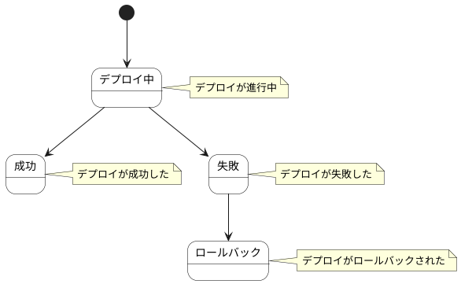

# デプロイ結果 ステートチャート

デプロイ結果情報の状態遷移を示します。

## 状態一覧

| 状態ID | 状態名 | 説明 |
|--------|--------|------|
| ST-AD-08 | デプロイ中 | デプロイが進行中 |
| ST-AD-09 | 成功 | デプロイが成功した |
| ST-AD-10 | 失敗 | デプロイが失敗した |
| ST-AD-11 | ロールバック | デプロイがロールバックされた |
