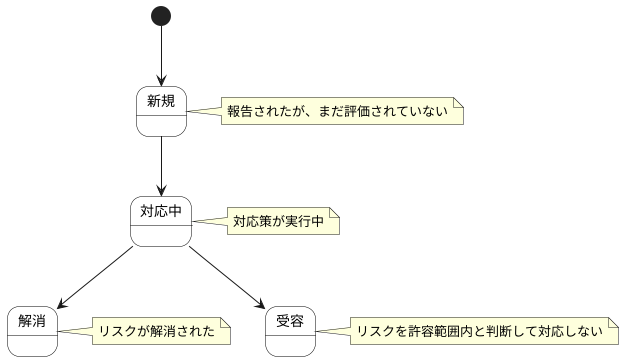

# リスク ステートチャート

リスク情報の状態遷移を示します。

## 状態一覧

| 状態ID | 状態名 | 説明 |
|--------|--------|------|
| ST-LR-06 | 新規 | 報告されたが、まだ評価されていない |
| ST-LR-07 | 対応中 | 対応策が実行中 |
| ST-LR-08 | 解消 | リスクが解消された |
| ST-LR-09 | 受容 | リスクを許容範囲内と判断して対応しない |
