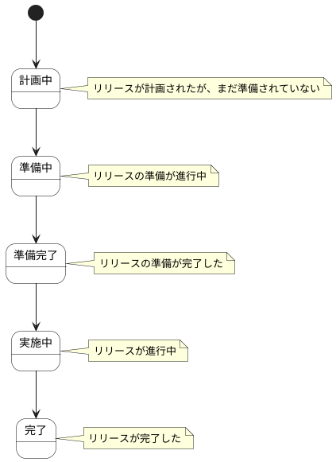

# リリース計画 ステートチャート

リリース計画情報の状態遷移を示します。

## 状態一覧

| 状態ID | 状態名 | 説明 |
|--------|--------|------|
| ST-AD-01 | 計画中 | リリースが計画されたが、まだ準備されていない |
| ST-AD-02 | 準備中 | リリースの準備が進行中 |
| ST-AD-03 | 準備完了 | リリースの準備が完了した |
| ST-AD-04 | 実施中 | リリースが進行中 |
| ST-AD-05 | 完了 | リリースが完了した |
