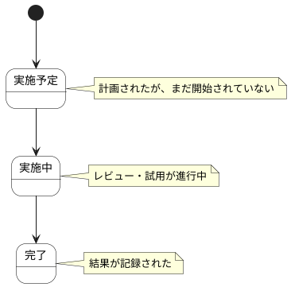

# 利用者レビュー ステートチャート

利用者レビュー情報の状態遷移を示します。

## 状態一覧

| 状態ID | 状態名 | 説明 |
|--------|--------|------|
| ST-LR-10 | 実施予定 | 計画されたが、まだ開始されていない |
| ST-LR-11 | 実施中 | レビュー・試用が進行中 |
| ST-LR-12 | 完了 | 結果が記録された |
