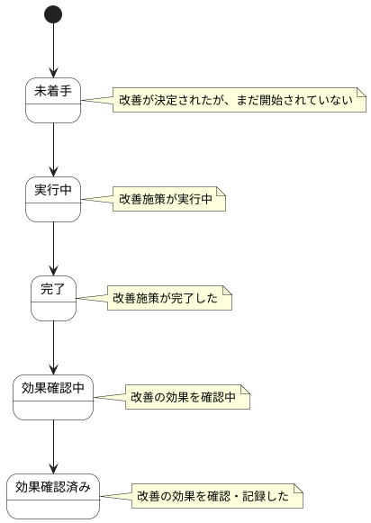

# 改善アクション ステートチャート

改善アクション情報の状態遷移を示します。

## 状態一覧

| 状態ID | 状態名 | 説明 |
|--------|--------|------|
| ST-LR-01 | 未着手 | 改善が決定されたが、まだ開始されていない |
| ST-LR-02 | 実行中 | 改善施策が実行中 |
| ST-LR-03 | 完了 | 改善施策が完了した |
| ST-LR-04 | 効果確認中 | 改善の効果を確認中 |
| ST-LR-05 | 効果確認済み | 改善の効果を確認・記録した |
