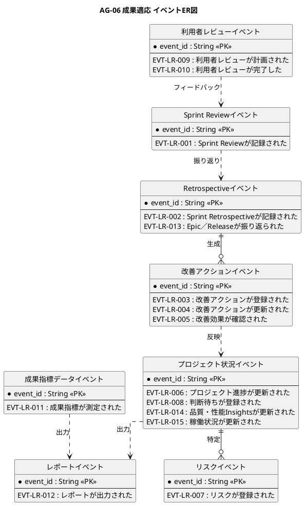

# イベントER図

成果適応業務領域で発生するドメインイベントの関係を示すER図です。

## 1. 目的

本書は、AG-06 成果適応業務領域のシステムレイヤーで発生するドメインイベント間の関係を示すER図です。

## 2. PlantUML ER図



## 3. 日本語版 ER図

```plantuml
@startuml
title AG-06 成果適応 イベントER図（日本語版）
hide circle
skinparam linetype ortho
skinparam shadowing false
skinparam entity {
  BackgroundColor #F8FAFC
  BorderColor #475569
  FontColor #0F172A
}
skinparam packageStyle rectangle

entity "Sprint Reviewイベント" as SprintReviewEvents {
  * イベントID : String <<PK>>
  --
  EVT-LR-001 : Sprint Reviewが記録された
}

entity "Retrospectiveイベント" as RetrospectiveEvents {
  * イベントID : String <<PK>>
  --
  EVT-LR-002 : Sprint Retrospectiveが記録された
  EVT-LR-013 : Epic／Releaseが振り返られた
}

entity "改善アクションイベント" as ImprovementActionEvents {
  * イベントID : String <<PK>>
  --
  EVT-LR-003 : 改善アクションが登録された
  EVT-LR-004 : 改善アクションが更新された
  EVT-LR-005 : 改善効果が確認された
}

entity "プロジェクト状況イベント" as ProjectStatusEvents {
  * イベントID : String <<PK>>
  --
  EVT-LR-006 : プロジェクト進捗が更新された
  EVT-LR-008 : 判断待ちが登録された
  EVT-LR-014 : 品質・性能Insightsが更新された
  EVT-LR-015 : 稼働状況が更新された
}

entity "リスクイベント" as RiskEvents {
  * イベントID : String <<PK>>
  --
  EVT-LR-007 : リスクが登録された
}

entity "利用者レビューイベント" as UserReviewEvents {
  * イベントID : String <<PK>>
  --
  EVT-LR-009 : 利用者レビューが計画された
  EVT-LR-010 : 利用者レビューが完了した
}

entity "成果指標データイベント" as MetricDataEvents {
  * イベントID : String <<PK>>
  --
  EVT-LR-011 : 成果指標が測定された
}

entity "レポートイベント" as ReportEvents {
  * イベントID : String <<PK>>
  --
  EVT-LR-012 : レポートが出力された
}

' Sprint ReviewからRetrospectiveへ
Sprint Reviewイベント ..> Retrospectiveイベント : 振り返り

' Retrospectiveから改善アクションへ
Retrospectiveイベント ||--o{ 改善アクションイベント : 生成

' 改善アクションからプロジェクト状況へ
改善アクションイベント ..> プロジェクト状況イベント : 反映

' プロジェクト状況からリスクへ
プロジェクト状況イベント ||--o{ リスクイベント : 特定

' 利用者レビューからSprint Reviewへ
利用者レビューイベント ..> Sprint Reviewイベント : フィードバック

' 成果指標データからレポートへ
成果指標データイベント ..> レポートイベント : 出力

' プロジェクト状況からレポートへ
プロジェクト状況イベント ..> レポートイベント : 出力

@enduml
```

## 4. イベントエンティティ一覧

| イベントエンティティ       | イベントID  | イベント名                             | 関連情報   | 集約                   |
|----------------------------|-------------|----------------------------------------|------------|------------------------|
| SprintReviewEvents         | EVT-LR-001  | Sprint Reviewが記録された              | INF-LR-01  | Sprint Review記録      |
| RetrospectiveEvents        | EVT-LR-002  | Sprint Retrospectiveが記録された       | INF-LR-02  | Retrospective記録      |
| RetrospectiveEvents        | EVT-LR-013  | Epic／Releaseが振り返られた            | INF-LR-02  | Retrospective記録      |
| ImprovementActionEvents    | EVT-LR-003  | 改善アクションが登録された             | INF-LR-03  | 改善アクション         |
| ImprovementActionEvents    | EVT-LR-004  | 改善アクションが更新された             | INF-LR-03  | 改善アクション         |
| ImprovementActionEvents    | EVT-LR-005  | 改善効果が確認された                   | INF-LR-03  | 改善アクション         |
| ProjectStatusEvents        | EVT-LR-006  | プロジェクト進捗が更新された           | INF-LR-05  | プロジェクト状況       |
| ProjectStatusEvents        | EVT-LR-008  | 判断待ちが登録された                   | INF-LR-05  | プロジェクト状況       |
| ProjectStatusEvents        | EVT-LR-014  | 品質・性能Insightsが更新された         | INF-LR-05  | プロジェクト状況       |
| ProjectStatusEvents        | EVT-LR-015  | 稼働状況が更新された                   | INF-LR-05  | プロジェクト状況       |
| RiskEvents                 | EVT-LR-007  | リスクが登録された                     | INF-LR-06  | リスク                 |
| UserReviewEvents           | EVT-LR-009  | 利用者レビューが計画された             | INF-LR-07  | 利用者レビュー結果     |
| UserReviewEvents           | EVT-LR-010  | 利用者レビューが完了した               | INF-LR-07  | 利用者レビュー結果     |
| MetricDataEvents           | EVT-LR-011  | 成果指標が測定された                   | INF-LR-08  | 成果指標データ         |
| ReportEvents               | EVT-LR-012  | レポートが出力された                   | INF-LR-09  | レポート               |

## 5. 主要な関係

- **Sprint Reviewイベント → Retrospectiveイベント**：レビューに基づく振り返り
- **Retrospectiveイベント → 改善アクションイベント**：振り返りからの改善アクション生成
- **改善アクションイベント → プロジェクト状況イベント**：改善状況の反映
- **プロジェクト状況イベント → リスクイベント**：リスクの特定
- **利用者レビューイベント → Sprint Reviewイベント**：利用者フィードバック
- **成果指標データイベント → レポートイベント**：指標データのレポート出力
- **プロジェクト状況イベント → レポートイベント**：状況情報のレポート出力
